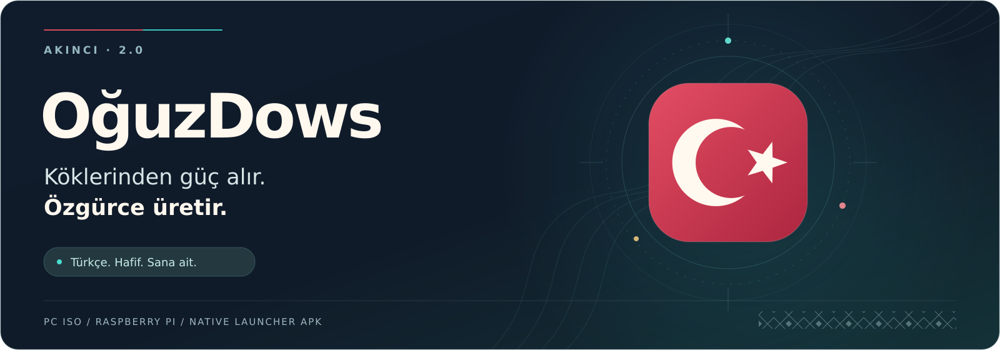

<p align="center">
  
</p>

<h1 align="center">Türkçe. Hafif. Sana ait.</h1>

<p align="center">
  Türkiye’den izler taşıyan, Xfce tabanlı bir canlı masaüstü ve kurulum ISO’su.<br>
  İhtiyacın olduğunda açılan araçlar, anlaşılır Türkçe ve kendine özgü bir masaüstü.
</p>

<p align="center">
  <a href="https://github.com/PeraPlusbirPasha/OguzDows/releases/tag/v1.0.0"><kbd>Yayın · v1.0.0</kbd></a>
  &nbsp; <kbd>amd64 + i386</kbd> &nbsp; <kbd>Xfce</kbd> &nbsp; <kbd>Türkçe</kbd>
</p>

<p align="center">
  <a href="#indir"><b>↓ İndir</b></a> &nbsp; · &nbsp;
  <a href="#ozellikler">Neler var?</a> &nbsp; · &nbsp;
  <a href="#manzaralar">Manzaralar</a> &nbsp; · &nbsp;
  <a href="#performans">RAM ölçümleri</a> &nbsp; · &nbsp;
  <a href="docs/TEKNIK-REHBER.md">Teknik rehber</a> &nbsp; · &nbsp;
  <a href="https://github.com/PeraPlusbirPasha/OguzDows/issues">Sorun bildir</a>
</p>

---

## Kaynak dalında: 1.1 ara güncellemesi

Sol menülü **ayrı canlı / kurulu karşılama**, açık / koyu tema ve özgün **XP esintili Başlat**, **derlenen C / GTK mağaza**, **20 kültür görseli** ve seçilen sesle **11 doğal Rıfkı kaydı** geliştiriliyor. Yeni **Cihaz Merkezi** destek düzeylerini açıklar; EXE / APK açıcı dosyayı önce inceler ve açık onay ister. Wine / Waydroid hazır değilse çalıştırmaz; güvenlik veya evrensel uyumluluk garantisi değildir.

**1.1 henüz Release olarak yayımlanmadı.** `79c6942` kaynağının amd64 / i386 geliştirme ISO’ları [PC Artifacts](https://github.com/PeraPlusbirPasha/OguzDows/actions/runs/45084956906), armhf / arm64 imajları [Pi Artifacts](https://github.com/PeraPlusbirPasha/OguzDows/actions/runs/45084959200) bölümündedir; geçici çıktılardır ve GitHub oturumu gerekebilir. PC tam Xfce **512 / 1024 MiB VM** kapıları iki mimaride geçti; 512 MiB’de en yüksek kullanım **amd64 277,4 MB / i386 194,8 MB**. Pi'de ARM kullanıcı-QEMU / host Xvfb üzerinde root olmayan tam Xfce ve armhf NetSurf yerel sayfası geçti; **fiziksel boot / GPU / hız kanıtı değildir**. [Kaynak kimlikli ölçüm kanıtı →](docs/V1.1-TEST-KANITI.md)

Bu imajlardan sonraki yeni kaynakta **elementary esintili macOS düzeni**, içeriğe oturan Windows 11 Başlat / görev grubu, **15 ayrı özgün uygulama simgesi**, bütçeli kısa pencere geçişleri ve **C / GTK Haber okuyucusu** eklendi. Ortak PC / Pi / ARM tariflerine bağlıdır; **445 yerel test**, Haberin geniş / 360px C/GTK kapıları, gerçek Picom/Xfwm ve iki panel sürümünde üç çözünürlükte görünür Windows11 merkezi (**0–3px**) geçti. Bu kaynak için [yeni PC](https://github.com/PeraPlusbirPasha/OguzDows/actions/runs/45170572813) / [Pi](https://github.com/PeraPlusbirPasha/OguzDows/actions/runs/45170576727) imajları birer kez başlatıldı; sonuçları beklenir. [Kapsam ve test sınırları →](docs/ELEMENTARY-HABER.md)

**Windows 11 dahil altı Xfce düzeni**, ayrı gerçek KDE/GNOME X11 kurulum / sonraki giriş seçimi ve kaynak bütçeli Aero bulunur. Mini/light başlangıç tam rehberi istek üzerine yükler; armhf temel web için NetSurf kullanır. **Pi Zero’da hesap ekranı sonrası siyah ekranın kök nedeni / fiziksel onarım sonucu henüz doğrulanmadı; yeni kod bu eski ISO’larda yoktur.** [Oturum ve Zero teşhisi →](docs/PI-ZERO-OTURUM.md)

Aşağıdaki kalıcı indirmeler, vitrin ve ana RAM tablosu **v1.0.0** içindir; etiket / dosyalar korunur. ARM64 / telefon katmanları önyüklenebilir telefon imajı değildir; fiziksel cihaz testleri bekliyor.

[1.1 uygulama kaydı →](docs/V1.1-GELISTIRME.md) · [Cihaz / EXE / APK sınırları →](docs/CIHAZLAR-VE-UYUMLULUK.md)

<a id="indir"></a>

## Bir USB ile başla

**Güncel yayın: [OğuzDows 1.0 · Ay Yıldız — v1.0.0](https://github.com/PeraPlusbirPasha/OguzDows/releases/tag/v1.0.0)**

ISO’lar herkese açıktır; indirmek için GitHub hesabı gerekmez.

| Bilgisayarın | İmaj | Boyut¹ | Bütünlük dosyası |
| :--- | :--- | ---: | :--- |
| **64 bit PC** · BIOS / 64 bit UEFI | **[amd64 ISO’yu indir ↗](https://github.com/PeraPlusbirPasha/OguzDows/releases/download/v1.0.0/OguzDows-amd64.iso)** | 1,74 GB | [SHA-256](https://github.com/PeraPlusbirPasha/OguzDows/releases/download/v1.0.0/OguzDows-amd64.iso.sha256) |
| **32 bit PC** · i686/PAE · BIOS | **[i386 ISO’yu indir ↗](https://github.com/PeraPlusbirPasha/OguzDows/releases/download/v1.0.0/OguzDows-i386.iso)** | 1,41 GB | [SHA-256](https://github.com/PeraPlusbirPasha/OguzDows/releases/download/v1.0.0/OguzDows-i386.iso.sha256) |

<sub>¹ Yuvarlanmış decimal GB. i386 tarayıcısı için SSE2 gerekir. ASUS X553M için amd64 seçilir. Bu yayın Raspberry Pi imajı içermez.</sub>

### İndir → doğrula → dene

1. **ISO’yu ve ona ait SHA-256 dosyasını** aynı klasöre indir. Örneğin Linux’ta:
   ```sh
   sha256sum -c OguzDows-amd64.iso.sha256
   ```
   Sonucun `OK` olması gerekir. İki imajı birlikte indirdiysen [SHA256SUMS](https://github.com/PeraPlusbirPasha/OguzDows/releases/download/v1.0.0/SHA256SUMS) ile ikisini de denetleyebilirsin.
2. ISO’yu güvendiğin bir imaj yazma aracıyla USB’ye yaz. **USB’nin içeriği silinir; doğru aygıtı seç.**
3. USB’den aç, **OğuzDows’u dene** ile donanımını kontrol et. Hazır olduğunda **OğuzDows’u kur** seçeneğini kullan.

> [!IMPORTANT]
> **Önce yedek al.** Secure Boot kapalı olmalıdır; 32 bit UEFI desteklenmez. Canlı ortam hesabı `oguz` / `oguz`’dur; parolasız yönetici yetkisi yalnızca canlı ortam içindir. Kurulu sistemde kendi kullanıcı/parolan belirlenir ve canlı hesap temizlenir. Yeni ISO, mevcut kurulumunu kendiliğinden değiştirmez.

<a id="ozellikler"></a>

## Tanıdık hissettirir. Kendi karakterini taşır.

| Gündelik kolaylık | OğuzDows dokunuşu |
| :--- | :--- |
| **🇹🇷 Baştan sona Türkçe**<br>Türkçe Q klavye, İstanbul saat dilimi, anlaşılır karşılama ve OğuzDows kimliği taşıyan kurulum ekranları. | **🪶 Hafif Xfce masaüstü**<br>Opak ve okunaklı panel/başlıklar; varsayılan kapalı görsel efektler. Mağaza ve güncelleyici için otomatik başlayan süreç yok. |
| **🔧 OğuzDows Güncelleyici**<br>Önce paket/sürüm planını gör, sonra açık onay ve yönetici doğrulamasıyla ilerle. Donanımla eşleşen firmware önerilerini incele. | **📦 Uygulamalar, sen isteyince**<br>GNOME Yazılımlar + Flatpak. Flathub uygun mimaride ve kullanıcı onayıyla eklenir. Snap yok; otomatik indirme kapalı. |
| **🎨 Beş farklı tarz**<br>OğuzDows, KDE tarzı, GNOME tarzı, Klasik Xfce ve Mac esintisi: aynı hafif masaüstünde geri alınabilir görünümler. | **🐾 Rıfkı yanında**<br>İsteğe bağlı, hafif Van kedisi rehber; çevrimdışı Türkçe yazılı yardım ve yerel konuşma kayıtları. Mikrofon veya ağ üzerinden sohbet yok. |

**İnce dokunuşlar:** yerel hareketli **tespih imleci**, **nazar boncuğu pil göstergesi**, ay-yıldızlı açılış animasyonu, güvenli görüntü / düşük bellek önyükleme seçenekleri ve altı Türkiye esintili manzara.

**Kurulumda sürpriz değil, açık sonuç:** kurucu başarı, iptal, hata ve doğrulanamayan sonucu ayırır; sonuç ekranı kendiliğinden kaybolmaz. Yeniden başlatma ayrıca onay ister. Ek sürücü uyarısı, temel kurulum başarısı gibi sunulmaz.

### Biraz da bizden

| Araç | Ne yapar? |
| :--- | :--- |
| **🍵 Çay Molası** | Kısa bir nefes için istek üzerine açılan mola aracı. |
| **⌨️ Türkçe Hızlı Yazım** | `I/ı` ve `İ/i` dahil Türkçe yazım alıştırmaları. |
| **🎒 Heybe** | Senin seçtiğin klasörlerden yerel yedek arşivi oluşturur. |
| **🤝 İmece** | Seçtiğin dosyaları paylaşmaya hazır yerel bir ZIP’e koyar. |

Bu araçlar kendiliğinden dosya yüklemez, paylaşmaz veya kaynak silmez. Heybe/İmece arşivleri **şifreli değildir**; özel içeriklerini kontrol et.

<a id="manzaralar"></a>

## Masaüstünde Türkiye’den izler

<table>
  <tr>
    <td width="33%" align="center"><a href="system/usr/share/backgrounds/oguzdows/bogaz-sabahi.jpg"></a><br><b>Boğaz Sabahı</b></td>
    <td width="33%" align="center"><a href="system/usr/share/backgrounds/oguzdows/kackar-sisi.jpg"></a><br><b>Kaçkar Sisi</b></td>
    <td width="33%" align="center"><a href="system/usr/share/backgrounds/oguzdows/kapadokya-isigi.jpg"></a><br><b>Kapadokya Işığı</b></td>
  </tr>
  <tr>
    <td align="center"><a href="system/usr/share/backgrounds/oguzdows/oludeniz-kiyisi.jpg"></a><br><b>Ölüdeniz Kıyısı</b></td>
    <td align="center"><a href="system/usr/share/backgrounds/oguzdows/tuz-golu-aksami.jpg"></a><br><b>Tuz Gölü Akşamı</b></td>
    <td align="center"><a href="system/usr/share/backgrounds/oguzdows/ani-kisi.jpg"></a><br><b>Ani Kışı</b></td>
  </tr>
</table>

Her manzaranın sağ altında **OğuzDows logosu** bulunur. 1920×1080 yerel görseller; ağdan indirme veya sürekli çalışan slayt servisi yoktur. Özel duvar kâğıdın korunur.

<sub>Görseller yapay zekâ üretimidir; gerçek kamera fotoğrafı veya birebir coğrafi belge değildir. Bu galeri masaüstü ekran görüntüsü değil, paketlenen duvar kâğıtlarının önizlemesidir. [Görsel ve ses kaynakları →](artwork/README.md)</sub>

<a id="performans"></a>

## Hafiflik, yalnızca bir sıfat değil

**Yayımlanmış v1.0.0 için 600 MB boşta RAM hedefi**, üretilen ISO içeriğinden hazırlanan test diskinde gerçek **tam Xfce oturumu** açılarak ölçüldü. 1.1 geliştirme sonucu yukarıda ve [ayrı kanıt kaydındadır](docs/V1.1-TEST-KANITI.md).

| İmaj | En yüksek kullanım | 600 MB hedefi |
| :--- | ---: | :---: |
| **amd64** | **459,0 MB** | Geçti ✓ |
| **i386** | **518,8 MB** | Geçti ✓ |

**Koşullar:** ağsız QEMU/TCG · 2 GiB RAM · 2 sanal CPU · std VGA · 120 saniye yerleşme + 6 örnek. Yöntem `MemTotal − MemAvailable`, decimal MB; süreç RSS toplamı değildir. Rehber, Rıfkı, mağaza ve güncelleyici kapalıdır.

Bu, her fiziksel bilgisayarın aynı miktarda RAM kullanacağı anlamına gelmez. Gerçek KDE/GNOME oturumları ve Raspberry Pi bu ölçümün kapsamında değildir. **[Yöntem, ham raporlar ve doğrulama sınırları →](docs/MASAUSTU-TEST-KANITI.md)**

### Donanım için kısa rehber

| | Beklenti |
| :--- | :--- |
| **İşlemci** | amd64 için 64 bit x86; i386 için i686/PAE, tarayıcı için SSE2. |
| **Bellek** | Günlük kullanım için **en az 2 GiB önerilir**. Canlı ortam/kurucu en az 1 GiB kontrolü yapar; tarayıcı/ofis ek bellek ister. |
| **Disk** | Kurulumda en az **12 GiB boş alan** kontrol edilir; uygulama ve dosyaların için ek yer ayır. |
| **Önyükleme** | amd64 BIOS + 64 bit UEFI; i386 BIOS. **Secure Boot kapalı** olmalı. |
| **Eski aygıtlar** | Eski görüntü/ağ firmware’leri ve lisans onaylı çevrimdışı ek sürücü akışı. Her donanım için uyumluluk garantisi yoktur. |

Siyah ekranda **güvenli görüntü**, az bellekte **düşük bellek** açılışını dene. Donanım merkeziyle sürücü durumunu incele; rastgele depolardan sistem/çekirdek paketi karıştırma. [Sürücü ve kurulum ayrıntıları →](docs/TEKNIK-REHBER.md#eski-cihazlar-ve-sürücüler)

## Senin sistemin, senin kararın

- **Onay önce gelir.** Kurulum, ek sürücü, güncelleme ve isteğe bağlı depo işlemlerinde açık kullanıcı/yönetici onayı gerekir. Heybe/İmece dosyalarını otomatik göndermez.
- **Pardus kanalı varsayılan kapalıdır.** Yalnızca uygun amd64/trixie tabanında, sabit anahtar ve güncel imza/mimari/tarih/pin denetimleriyle dar uygulama listesi değerlendirilir. Genel sistem deposu karıştırılmaz.
- **KDE/GNOME tarzı ≠ gerçek KDE/GNOME.** 1.1 kaynak dalındaki altı tarz Xfce görünümüdür. Gerçek masaüstleri amd64 / ARM64’te ayrıca, daha yüksek kaynak beklentisi ve onaylı paket planıyla sunulur; gerçek giriş oturumları henüz doğrulanmadı.
- **Sınırlar saklanmaz.** Gerçek yetkili APT/Flatpak kurulum işlemleri, şifreli tam kurulum ve her fiziksel aygıt bu testlerle doğrulanmış sayılmaz. i386/eski ARM için Flathub kapsamı varsayılmaz.
- **Rıfkı bilinçli olarak hafiftir.** Pencere takip eden ağır animasyonlar kaldırıldı. Konuşmalar yapay zekâ ile hazırlanmış yerel kayıtlardır; 1.1’de panel rehberleri yerel kayıtlara bağlıdır; değişken hata / haber metni otomatik seslendirilmez.

[Masaüstü ve bakım rehberi →](docs/MASAUSTU-VE-BAKIM.md)

## Raspberry Pi için ayrı bir yol

Zero–5 ailesi için ayrı `armhf` / `arm64` SD/USB imajı akışı bulunur. PC ISO’su Pi’ye yazılmaz; Pi’de ilk açılışta kişisel hesap oluşturulur, ortak canlı parola veya parolasız sudo yoktur.

**Bu PC release’inde Pi imajı yoktur; fiziksel Pi açılışı ve performansı henüz doğrulanmadı.** Resmî Pi OS/pi-gen kaynaklarıyla mimari karşılaştırma yapıldı: başsız Xfce testi, teknik taban kimliği ve ağ bekleme sırası düzeltildi; ortak özellik / ARM ABI / 20 görsel + seçili 11 doğal kayıt için her sürümde çalışan yapı kapıları eklendi. Yeni tam imaj sonucu ayrıca doğrulanmalıdır; ARMv6 / 512 MB için modern PC hızı vaat edilmez. [Mimari karşılaştırma ve portlama verisi →](docs/ARM-MIMARI-VE-PORTLAMA.md) · [Pi rehberi →](raspberrypi/README.md)

## Yeni bir sayfa, yeni bir ana sürüm

```text
v1.0.0  ·  Ay Yıldız — yayımlandı
   ↓
v1.1    ·  Ara güncelleme — geliştirme
   ↓
v2.0    ·  Bir sonraki ana yayın
   ↓
v3.0    ·  Sonraki ana yayın
```

Bundan sonraki yeni ana yayınlar **v2.0, v3.0, …** olarak ilerler. Bu bir sürümleme düzenidir; takvim veya henüz tamamlanmamış özellikler için söz değildir. **Mevcut v1.0.0 etiketi ve ISO’ları yeniden adlandırılmaz.** Her yeni yayın kendi kaynak commit’i, ISO’ları, SHA-256 dosyaları, Türkçe sürüm notları ve test kanıtlarıyla paylaşılır.

[Yayın ve sürümleme politikası →](docs/SURUM-POLITIKASI.md) · [Tüm yayınlar →](https://github.com/PeraPlusbirPasha/OguzDows/releases)

## Merak edenler ve katkı verenler için

```sh
# ISO üretmeden, çevrimdışı yapılandırmayı incele:
python3 scripts/configure.py --arch amd64 --output /tmp/oguzdows-config

# Test bağımlılıkları hazırken yerel kontroller:
python3 -m unittest discover -s tests -p 'test_*.py' -v
```

Tam ISO derlemesi root, ağ ve yeterli disk alanı gerektirir. Hazırlık adımları, test ortamı, kaynak düzeni ve temizlik kuralları **[teknik rehberde](docs/TEKNIK-REHBER.md)**. Çalışan bir ISO/Pi işi yeni bir iş geldi diye iptal edilmez.

| Yol gösterici | İçerik |
| :--- | :--- |
| [Teknik rehber](docs/TEKNIK-REHBER.md) | Derleme, kurulum güvenliği, eski sürücüler, Rıfkı ve geliştirici testleri. |
| [Masaüstü ve bakım](docs/MASAUSTU-VE-BAKIM.md) | Mağaza, güncelleyici, tarzlar, kültür araçları ve depo güveni. |
| [Test kanıtı](docs/MASAUSTU-TEST-KANITI.md) | Kaynak kimliği, ISO hash’leri, açılış testleri ve tam Xfce RAM sonuçları. |
| [Kurulum karşılaştırması](docs/KURULUM-KARSILASTIRMA.md) | Kali/Linux Mint kaynak incelemesi ve kurulum kontrollerinin gerekçeleri. |
| [Raspberry Pi](raspberrypi/README.md) | ARM hedefleri, ilk hesap, güvenlik ve fiziksel test sınırları. |

Bir sorun bildirirken cihaz modelini, ISO mimarisini/sürümünü ve kişisel bilgileri ayıklanmış hata çıktısını ekle. Donanım raporun **kendiliğinden gönderilmez**.

---

<sub>OğuzDows PC tabanı amd64 için Debian trixie, i386 için Debian bookworm’dur. Xfce, Calamares, GNOME Software, Flatpak ve diğer üçüncü taraf bileşenlerin köken, telif ve lisans bilgileri korunur. Ürün kimliği, bu bilgileri gizlemek anlamına gelmez.</sub>

<p align="center"><b>Biraz Anadolu. Biraz merak. Bolca emek.</b><br><sub>OğuzDows · Ay Yıldız</sub></p>
