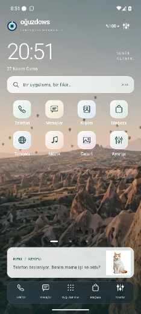

# OğuzDows Mobile 0.3 · launcher’ı dene

**Native launcher APK’sı hazır: `0.3.0-launcher`.** Kotlin + Jetpack Compose ana ekranı, gerçek kurulu uygulamalar, kalıcı kısayollar, sistem widget’ları ve yerel Rıfkı. Telefon/SMS/Mağaza kabulü korunarak **17/17 emülatör testi geçti**. Bu bir **debug uygulamasıdır**; telefon ROM’u, OTA, GSI veya ISO değildir.

## 1. İndir

### [Launcher APK + testler + raporlar paketini indir](https://github.com/PeraPlusbirPasha/OguzDows/actions/runs/46065713858/artifacts/15231331173)

- [Başarılı derleme ve kabul koşusu](https://github.com/PeraPlusbirPasha/OguzDows/actions/runs/46065713858) · tam kaynak **`fb6cad5a3f56c5bf37e739388ded5ffce8e5ad13`**.
- Artifact: `oguzdows-mobile-emulator-46065713858`. GitHub oturumu gerekebilir. **14 gün saklanır**; kalıcı mobil Release yayımlanmadı.
- ZIP’i açıp `SHA256SUMS` bulunan `package/` klasörüne gir. APK’ların yanında raporlar ve tam çözünürlüklü emülatör ekran görüntüleri de bulunur.

| Dosya | Kullanımı |
| --- | --- |
| **`OguzDows-Mobile-0.3.0-launcher-debug.apk`** | Kurulacak ana launcher; **23.991.680 bayt** |
| `OguzDows-Mobile-0.3.0-launcher-tests.apk` | Otomatik instrumentation testleri; günlük uygulama değil |
| `OguzDows-inert-install-fixture.apk` | Kurulum/widget testlerinin etkisiz örneği; elle kurmana gerek yok |
| `SHA256SUMS`, `APK-SIGNATURE.txt`, `BUILD.txt` | Hash’ler, CI imza denetimi ve tam kaynak commit’i |

GitHub CLI ile de indirilebilir:

```sh
gh run download 46065713858 --repo PeraPlusbirPasha/OguzDows \
  --name oguzdows-mobile-emulator-46065713858 --dir oguzdows-mobile-0.3
```

**Bu çalışma alanındaki sınır:** CI paketi hazırlayıp yükledi ve `apksigner verify` geçti. Sandbox’ın GitHub artifact depolama yönlendirmesine erişimi ise `EOF` ile kesildi; **APK burada açılamadı, bağımsız yerel hash/imza doğrulaması yapılamadı**. Aşağıdaki değerler başarılı CI kaydıdır. [Paket kökeni ve ZIP digest’i](android/evidence/package-fb6cad5.json). İndirdiğin kendi kopyanı doğrula.

## 2. Doğrula

Ana APK için beklenen SHA-256:

```text
622a59fd5686b09da687a6b6f7e72f24963341695b210a3addbf58c292eefb56
```

`SHA256SUMS` bulunan klasörde Linux/WSL:

```sh
sha256sum -c SHA256SUMS
```

Windows PowerShell:

```powershell
Get-FileHash .\OguzDows-Mobile-0.3.0-launcher-debug.apk -Algorithm SHA256
```

Değer farklıysa kurma. İmza **debug imzasıdır**, üretim imzası veya malware taraması değildir. Koşuların test anahtarları değişebilir; eski debug kuruluma güncelleme garantisi yoktur. İmza uyuşmazlığını aşmak için günlük telefon verilerini silme; temiz bir emülatör kullan.

## 3. Boş emülatöre kur ve ana ekran yap

Android Studio AVD Manager’da **Pixel 6 · API 35 · Google APIs · x86_64 · 4 GB RAM** oluştur ve başlat. Doğrulanan konuk budur; Play Store imajı değildir. ARM konuk, başka API ve OEM’ler ayrıca sınanmalıdır.

Fiziksel telefonlarını adb’den ayır. Aşağıdaki komutlar yalnız `emulator-5554` içindir; `adb devices` başka `emulator-*` numarası gösterirse onu kullan. **QEMU çıktısı `1` değilse devam etme.**

```sh
adb devices
adb -s emulator-5554 shell getprop ro.kernel.qemu
# Çıktı 1 olmalı.
adb -s emulator-5554 install -t OguzDows-Mobile-0.3.0-launcher-debug.apk
adb -s emulator-5554 shell am start -n org.oguzdows.mobile/.LauncherActivity
```

1. OğuzDows’ta **Ana ekran yap** düğmesine bas ve sistem seçiminde OğuzDows’u onayla. Alternatif: sistem **Ayarlar → Uygulamalar → Varsayılan uygulamalar → Ana ekran**.
2. Telefonun/emülatörün **Home** hareketi artık native OğuzDows’a dönmeli. Ana ekran WebView değildir; günlük araçların bir kısmı paketlenmiş modül arayüzünü kullanır.
3. Telefon ve SMS, HOME’dan **ayrı rollerdir**. Yalnız bu boş emülatörde ilgili modüllerin rol/izin düğmelerini kullan. Çağrı/SMS için ayrıca alıcı ve ücretli işlem onayı gerekir; rol seçmek kendiliğinden arama/mesaj başlatmaz.

Bootloader açma, flash veya root gerekmez. Geri dönmek için sistemin **Varsayılan uygulamalar → Ana ekran** bölümünde stok launcher’ı seçebilirsin. Bu seçim uygulama/SMS verilerini silmez.

## 4. Neleri dene?

- **Uygulamalar:** arama çubuğu veya alt çekmece düğmesi → gerçekten kurulu uygulamayı Türkçe adı/paket adıyla bul ve aç. Liste erişilebilir kullanıcı profillerini ayırır; gerçek badged simgeler kullanılır.
- **Masaüstün:** çekmecedeki **+** ile sabitle; kısayola basılı tutarak öne/sona taşı veya kaldır. İki kısayol sayfası, varsayılan 12/en çok 16 giriş; değişiklikler diske yazılır. Koleksiyon’dan dört arka plandan birini seç.
- **Widget:** üçüncü sayfa → **+ Widget** → cihazdaki gerçek sağlayıcıyı seç → gerekiyorsa sistem bağlama/yapılandırma onayı. En çok iki sabit boyutlu alan. Kabulte gerçek sağlayıcı RemoteViews’ı, host yeniden yaratıldığında geri gelmesi ve kaldırma sınandı.
- **Denetim:** üst başlıktan aşağı kaydır veya sağ üst denetim düğmesine bas. Medya sesi gerçek sistem kanalını, parlaklık yalnız OğuzDows penceresini değiştirir. Gece mavisi kendi Telefon ve diğer yerel ekranlarıyla ortak tercihtir; başka üreticilerin uygulamalarını zorlamaz.
- **Rıfkı:** karta dokun, yaz; kediyi sev veya ana ekranda sağa/sola sürükle. Saat/pil/şarj/görüşmeye tepki verir, sabit ve açık onaylı arayüz eylemleri önerir. **Şimdilik yerel kural tabanlıdır; konuşan bulut AI, mikrofon ve wake-word bağlı değil.**
- **Telefon/SMS:** kendi görüşme ekranı ve gerçek sistem sağlayıcısı korunur. Emülatör kabulü gelen/giden sanal çağrı ve SMS’i içerir; gönderim callback’i teslim raporu yerine geçirilmez.
- **Mağaza:** imzalı F-Droid kaynağını açıkça eşitle; canlı API/ABI filtreli kataloğu ve APK incelemesini gör. Kabulte **5.057 uygulama / 5.016 uygun paket** gözlendi; zamanla değişir, hepsinin çalıştığı anlamına gelmez. Canlı Aegis incelemesi **kurmadan iptal**, ayrı etkisiz fixture ise gerçek sistem onayıyla kurulumdur.

### Gerçek native emülatör görüntüsü



Bu **234×520** görüntü çalışan API35 emülatöründeki `UiDevice` ekran görüntüsünün küçültülmüş JPEG’idir; web önizlemesi, tasarım maketi veya fiziksel telefon fotoğrafı değildir. Tam PNG’ler artifact’tadır. Kaynak ve hash [cihaz kanıtında](android/evidence/emulator-fb6cad5.json).

## Kabul ve sınırlar

**Geçen:** 11 seçimde **17 gerçek emülatör vakası** (8 Telefon/SMS/köprü/yükleyici + 5 native launcher + 3 depo güvenliği + 1 canlı kaynak), **13 JVM testi**, **15 kaynak sözleşmesi**; Node testleri **31/31**, tarayıcı raporu **33/33**. Lint **0 hata / 43 uyarı**. [Ayrıntılar ve korunan başarısız koşular](VERIFICATION.md) · [tekrar üretim](android/README.md).

**Henüz değil:** fiziksel SIM/operatör/acil çağrı, MMS/RCS, çoklu SIM/çağrı ve tüm izin/lock-screen/süreç ölümü matrisi; gerçek telefon RAM/FPS/pil ölçümü; GMS/Play lisansı/sertifikası, Integrity/banka/DRM veya bütün APK’lerle uyumluluk; üretim imzası ve cihaz işletim sistemi imajı. HOME/yardımcı/Telefon/SMS rolleri birbirinden ayrıdır.

**Günlük fiziksel telefonunda varsayılan Telefon/SMS uygulamanı bu deneysel paketle değiştirme.** ROM için tam marka/model/kod adı/yazılım sürümü ve stok geri dönüş yolu incelenmeden flash komutu hazırlanmaz. GNOME Software/Flatpak APK/GMS motoru değildir.

Önceki kabul edilmiş 0.2 test APK’sının [SDK](android/evidence/sdk-023a89c.json), [cihaz](android/evidence/emulator-023a89c.json) ve [paket](android/evidence/package-023a89c.json) kayıtları korunur; yukarıdaki indirme **0.3 native launcher** içindir. PC/Pi v1.2 imajları değiştirilmedi; PR birleştirilmedi ve mobil Release yayımlanmadı.
