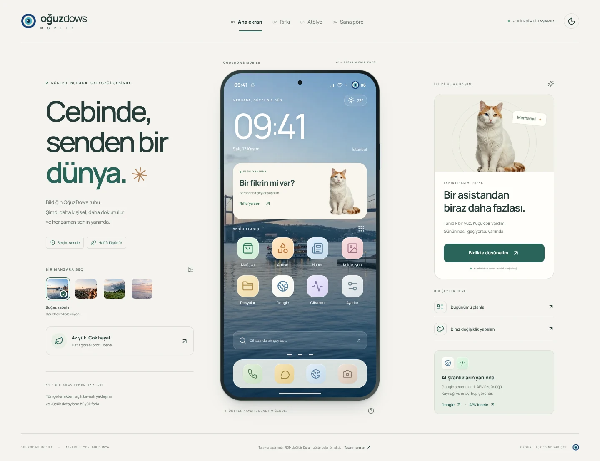
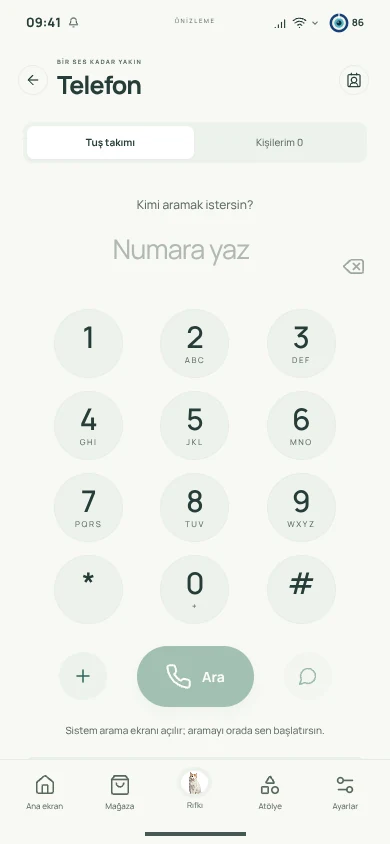
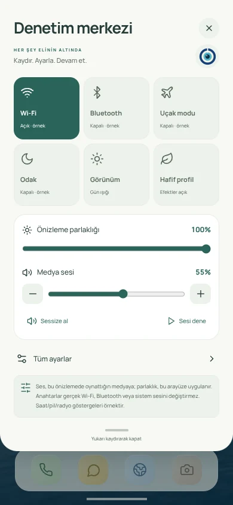

# OğuzDows Mobile

**Cebinde, senden bir dünya.**

OğuzDows’un Türkçe kimliği, nazar boncuğu güç simgesi, Rıfkı’sı, kültür koleksiyonu ve yerel araçları için **etkileşimli mobil tasarım + ayrı, henüz derlenmemiş yerel başlatıcı/yardımcı iskeleti**.

> **Bu bir telefon ROM’u veya APK çalıştırıcısı değildir.** Bu aşamada cihaz imajı ve native APK üretilmedi; fiziksel telefon, GMS, gerçek APK kurulumu veya canlı üretken model testi yapılmadı. PC/Pi v1.2 dosyaları ve yayınları değiştirilmez.



## Deneyebildiklerin

- **Ana ekran:** Boğaz duvar kâğıdı, pastel yerel simgeler, yatay kaydırılan **üç gerçek ana sayfa**, 20 uygulamalık çekmece, Türkçe arama, dokunma/basış geri bildirimi. Dar ekranda telefon çerçevesi kaybolur; arayüz ekranı doldurur.
- **Nazar boncuğu güç menüsü:** tasarım kilidi, önizlemeyi kapatma/yeniden açma; gerçek cihaz kapatılmış gibi gösterilmez. Webde saat/pil/hava örnektir; native iskelet pil düzeyini sistemden okumak üzere yazılmıştır.
- **Rıfkı:** mevcut kedi karakteri korunur. Yerel rehber sabit, onaylı arayüz eylemleri önerir; keyfî komut çalıştırmaz. İsteğe bağlı üretken model için sunucu köprüsü vardır; varsayılan kapalıdır ve canlı modelle denenmemiştir.
- **Atölye:** 16 aracın tamamı görünür; **10 araç etkileşimlidir**, diğer 6’sı yerel entegrasyon gerektirdiğini açıkça gösterir. Görev/not/metin rafı, SHA-256, JSON, hesap, birimler, renk kontrastı, dünya saatleri ve Türkçe metin işlemleri. Masaüstüyle tam eşdeğerlik iddiası yok; [sınırlar](feature-parity.json).
- **Mağaza:** aranabilir örnek katalog, kalıcı istek listesi, resmî geliştirici/Play bağlantıları. İndirme boyutu/sürümü uydurulmaz; kaynak sayfasını açmak “kuruldu” diye işaretlenmez.
- **APK inceleme:** kullanıcının seçtiği en çok 32 MiB dosyanın ZIP başlangıcı ve gerçek SHA-256 özeti; dosya yüklenmez, arşiv açılmaz, APK kurulmaz. İmza veya zararlı yazılım doğrulaması değildir.
- **Google seçenekleri:** Google/Gmail/Haritalar/YouTube/Drive/Çeviri için açıkça etiketli dış web bağlantıları. Hesap/parola bu önizlemeye girilmez. GMS/Play Store ROM’a paketlenmez.
- **Haber & okuma:** üç özgün, çevrimdışı örnek metin; okuma listesi, okundu filtresi, TXT indirme. Canlı haber sunuluyormuş gibi gösterilmez.
- **Kişiselleştirme:** gerçek ortak açık/koyu tema, üç vurgu, dört kültür duvar kâğıdı, kompakt düzen, hafif/azaltılmış hareket. Sistem `prefers-reduced-motion` tercihi de izlenir.
- **Dosyalar/kamera seçimi:** yalnız açıkça seçilen dosya okunur. Fotoğraf seçimi/kamera önerisi tarayıcının sistem seçicisine bağlıdır; sürekli kamera veya mikrofon yoktur.

## Günlük mobil deneyim

- **Arama gerçekten arar:** ana ekrandaki arama, uygulama adları/takma adları, kişiler, 16384 karakterlik not, görevler, Atölye araçları ve mağazada eşleşme bulur. Türkçe `I/İ/ı/i` desteklenir; basit hesap ifadesi de çözümlenir. Yazarken ağa sorgu gönderilmez.
- **Telefon:** tam ekran tuş takımı, elle/yapıştırarak numara girişi, artı/sil/kopyala, kişi seçme ve `tel:` bağlantısı. Son arama cihazın kendi Telefon uygulamasında başlatılır; webde modem veya bağlı çağrı simülasyonu yoktur. Servis kodları aktarılmaz.
- **Mesajlar ve Kişiler:** alıcı + kalıcı SMS taslağı, Türkçe gövdeyi güvenli kodlayan `sms:` geçişi. En çok 60 elle eklenen kişi; favori, düzenleme ve ikinci onayla silme. Sistem rehberi veya SMS geçmişi okunmaz, gönderilmiş balonu uydurulmaz.
- **Denetim merkezi:** ekranın **üst kenarından aşağı kaydır** veya durum çubuğuna dokun. Ses artır/azalt, kaydırıcı, sessiz ve kısa “Sesi dene”; parlaklık bu arayüzü gerçekten karartır. Ses, Müzik’teki gerçek oynatıcıya uygulanır; genel sistem sesini değiştirmez. Panelin alt tutamacını yukarı kaydırarak, kapat düğmesiyle veya Escape ile kapat.
- **Çeşitlilik:** Telefon, Mesajlar, Kişiler, Takvim, Saat, Müzik, Tarayıcı, Galeri, Hesap, Defter ve Günüm ile birlikte **20 uygulama girişi**. Takvimde en çok 80 yerel plan; Saat’te sayfalar arasında korunan kronometre/sayaç başlangıcı; Müzik’te 32 MiB’a kadar kendi ses dosyan; Galeri’de seçili 6 geçici fotoğrafı aç/indir/kaldır. Sistem alarmı/bildirim, kalıcı fotoğraf kitaplığı ve arka plan müzik servisi henüz yoktur.
- **Mağaza:** **24 uygulama / 8 kategori**, arama, kategori filtreleri, yerel marka SVG’leri ve istek listesi. Firefox, Signal, VLC, Organic Maps, Telegram, WhatsApp, Spotify, Bitwarden, Proton Mail, Nextcloud, Joplin, Obsidian, DuckDuckGo, Brave, KDE Connect, Wikipedia, AntennaPod, Element X, Aegis, Thunderbird, F-Droid, NewPipe, OsmAnd, Collabora Office. Katalog açık kaynak ve diğer lisanslı uygulamaları karıştırır; hepsi açık kaynak denmez. F-Droid/NewPipe için Play bağlantısı uydurulmaz.
- **Hareketler:** ana ekranda sola/sağa kaydır veya sayfa noktalarına dokun; aşağıdan yukarı çekerek çekmeceyi aç. Uygulama içi normal kaydırma/slider hareketi üst paneli yanlışlıkla açmaz. Yeni sayfa, simge ve panel geçişleri kısa; hafif profil ve sistem/uygulama azaltılmış hareket tercihi hepsini kapatır. Yalnız açıkça başlatılmış müzikte plak dönüşü vardır.

Telefon/SMS bağlantıları uygun işleyicisi olmayan masaüstü tarayıcısında uygulama açmayabilir. Kaynak kodda native `ACTION_DIAL`, `ACTION_SENDTO` ve sistem ses/Wi-Fi paneline aktarım da bulunur; henüz SDK/cihaz doğrulaması değildir.

## Ekranlar

| Ana ekran                                       | Rıfkı                                                      | Atölye                                             | Gece mavisi                                           |
| ----------------------------------------------- | ---------------------------------------------------------- | -------------------------------------------------- | ----------------------------------------------------- |
|  |  |  |  |

| Telefon                                                    | Denetim merkezi                                                      | Mağaza                                                      | Uygulamalar                                            |
| ---------------------------------------------------------- | -------------------------------------------------------------------- | ----------------------------------------------------------- | ------------------------------------------------------ |
|  |  |  |  |

Bunlar çalışan web önizlemesinden alınmıştır; fiziksel cihaz veya ROM görüntüsü değildir.

## Çalıştır

Node.js 22 ve npm ile:

```sh
cd mobile/preview
npm ci
npm run dev
```

Sunucu `0.0.0.0:5173` üzerinde dinler; Arena `.e2b.app` önizleme hostlarını kabul eder. Kullanıcının tarayıcısındaki API istekleri **yalnız göreli `/api/rifki/...`** yolunu kullanır, `localhost`a bağlanmaz.

```sh
npm run build          # TypeScript + üretim dosyaları
npm test               # sınır/hesap/kayıt/yerel rehber + model köprüsü testleri
npm run test:native    # yalnız manifest/kaynak sözleşmeleri; SDK derlemesi değil
npm run test:browser   # çalışan önizleme üzerinde gerçek Chromium akışları
npm run format:check
npm audit
```

Tarayıcı testleri için `npm run dev` ayrı terminalde çalışmalıdır. İsterseniz `MOBILE_BASE_URL` ile test sunucusunu, `PLAYWRIGHT_CHROMIUM_EXECUTABLE_PATH` ile sistem Chromium yolunu belirtin. Varsayılan CI tarayıcısı npm’de sabitlenen Sparticuz Chromium’dur; gereken NSS kitaplıkları yalnız test önbelleğine açılır. Tarayıcı güvenlik denetimini kapatan bayraklar kullanılmaz. Test tarayıcısının `--no-sandbox` ihtiyacı CI ortamına özgüdür; telefon güvenlik politikası değildir.

Üretim çıktısı `mobile/preview/dist/` içindedir ve Git dışında tutulur. `npm run preview`, aynı opsiyonel API köprüsüyle yerel üretim önizlemesi sunar; kimlik doğrulamalı bir üretim servisi değildir. Salt statik barındırmada yerel arayüz çalışır; sunucu API’si ayrıca uygulanmadıkça üretken model bağlı görünmez.

## Rıfkı: rehber başka, üretken model başka

**Varsayılan:** kural tabanlı, sınırlı yerel rehber. Mesajlar ağa gönderilmez; mikrofon, bildirim, Google hesabı veya ekran okunmaz. Sohbet yalnız bellektedir; not/görevler gibi kalıcı depoya yazılmaz.

**Opsiyonel gerçek model köprüsü:** OpenAI uyumlu bir sunucu veya yerel inference servisi. `.env.example` dosyasını `mobile/preview/.env` olarak kopyalayıp sunucu ortamında ayarlayın; dosya Git dışında tutulur. `.env` değişince sunucuyu yeniden başlatın.

- `RIFKI_ENABLED=true`, `RIFKI_API_BASE`, `RIFKI_MODEL`; gerekirse sunucuda `RIFKI_API_KEY`.
- Anahtarı **asla** `VITE_*` değişkenine, arayüze, belgeye veya sohbete koymayın.
- API base HTTPS olmalı; yalnız sunucunun yerel model bağlantısı için loopback HTTP kabul edilir. URL/anahtar kullanıcı arayüzünden alınmaz.
- Rıfkı → **Model** → bağlı sağlayıcıyı gör → gönderimi onayla → **yeni** model sohbeti aç. Eski yerel konuşma otomatik gönderilmez.
- Modelin araç/shell/dosya/kurulum yetkisi yoktur. Yanıt yalnız metin olarak çizilir; HTML olarak çalıştırılmaz.
- En çok 12 mesaj / mesaj başına 2000 / toplam 12000 karakter, 24 KiB istek, 64 KiB upstream yanıt, 600 token istek bütçesi, 20 s timeout; en çok 2 inference / süreç ve IP başına 8/dakika. Bu proxy-arkası IP sınırı kullanıcı kimlik doğrulaması değildir.
- Sağlayıcı hatası, anahtar veya cevap gövdesi loglanmaz/istemciye sızdırılmaz; bu kod sohbet kaydı tutmaz. **Sağlayıcının kendi veri saklama politikası bunun dışındadır.**

**Ücretli/uzak modeli herkese açık önizlemede açmadan önce** kullanıcı kimlik doğrulaması, proxy body/time limitleri, kullanıcı bazlı kota, TLS, kötüye kullanım kontrolü, sağlayıcı veri saklama sözleşmesi ve güvenlik incelemesi gerekir. Bu geliştirme köprüsünü doğrudan ücretli, anonim üretim servisi olarak kullanmayın. Bu oturumda gerçek inference çalıştırılmadı; köprü sözleşmeleri sahte upstream ile sınanır.

## Yerel başlatıcı ve varsayılan yardımcı

[`android/`](android/README.md), webview sarmalayıcı değildir: platform görünümleriyle HOME rolü, gerçek yüklü uygulama sorgusu, özel kopya üzerinden APK inceleme/sistem yükleyicisine onaylı aktarım, yerel notlar ve nazar simgesi için ayrı kaynak iskeletidir. `VoiceInteractionService` / session ve açık `RoleManager` seçimi, **Rıfkı’yı kullanıcının varsayılan yardımcısı** yapacak başlangıç yolunu tanımlar; herhangi bir başka yardımcı zorla kaldırılmaz. Hotword/mikrofon ve ekran bağlamı okuma eklenmedi. Bu kaynak henüz SDK ile derlenmedi veya emülatörde denenmedi; görsel tasarımın tam native portu değildir.

## Veriler ve sıfırlama

- Önizleme tercihleri/notlar/görevler/listeler, kişiler, SMS taslağı, takvim planları ve sayaç/kronometre başlangıcı: yalnız bu origin’in `localStorage` alanındaki `oguzdows.mobile.preview.v1`. **Şifreli değildir.** Paylaşılan tarayıcıda sır saklamayın.
- Bozuk/sürümü tanınmayan kayıt sessizce ezilmez; yazma durur, uyarı çıkar. Depolama engellenirse çalışma bellekte sürer, kalıcı kayıt iddia edilmez.
- Ayarlar → **Yalnız bu önizlemenin verilerini temizle** ikinci onay ister; diğer origin’lere, dosyalara, telefon veya masaüstü ayarlarına dokunmaz.
- APK/hash girdileri ve seçilen fotoğraf sunucuya gönderilmez. Sohbete bir dosyanın içeriğini kendiniz yazmanız ayrı bir açık gönderimdir.

## Gerçek cihaz sürümüne geçiş

[Ürün/sistem tasarımı](DESIGN.md) · [23 özellik ve platform eşlemesi](feature-parity.json) · [Native iskelet](android/README.md) · [Test kapsamı](VERIFICATION.md)

İlk ROM için **tam marka/model, kod adı ve mevcut yazılım sürümü** gerekir. ARM64 olmak tek başına telefon desteği değildir. Bootloader politikası, kernel/vendor ağaçları, modem/kamera/GPU sürücüleri, AVB/şifreleme, imzalı OTA ve geri dönüş yolu incelenmeden imaj veya flash komutu verilmeyecek. Google paketlerinin lisans/sertifika kapıları ve gerçek donanım testleri ayrıca geçilmeli.

### Varlıklar

Rıfkı ve duvar kâğıtları mevcut depo koleksiyonundan küçük WebP türevleridir; 24 yerel mağaza marka simgesinin kaynağı, lisansı, değişiklik ve hash kayıtları dahil [varlık atıfları](ASSETS.md). Font Manrope (SIL OFL), simgeler Lucide (ISC); bağımlılıklar lockfile’da sabittir. Ekran görüntüleri çalışan tarayıcıdan alınır; fiziksel telefon fotoğrafı veya cihaz testi değildir. Google/Android adları ilgili sahiplerine aittir; resmî ortaklık/sertifika iddia edilmez.
