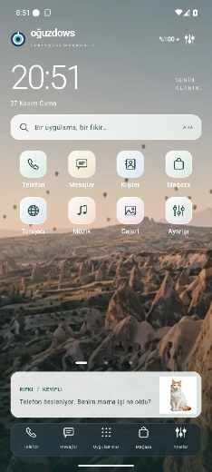
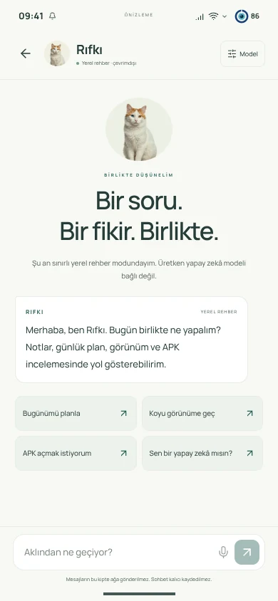

# OğuzDows Mobile

**Cebinde, senden bir dünya.**

> **`0.4.0-connected` hazır; tam emülatör kabulü geçti.** Altı mobil düzen ailesi, gerçek Ayarlar/tam ekran paneller, sistem rehberi, kilit eşlikçisi ve OğuzKöprü dosya/izinli yansıtma yolları aynı kaynakta doğrulandı. [Kapsam, sınırlar ve geçmiş → CONNECTED.md](CONNECTED.md). Fiziksel PC/telefon/ARM veya işletim sistemi imajı kabulü değildir.

**Kotlin + Jetpack Compose native launcher.** Gerçek HOME/LAUNCHER, Aero/cam kişiliği, nazar kimliği, gerçek kurulu uygulamalar, kalıcı masaüstü ve etkileşimli yerel Rıfkı; Telefon/SMS/Mağaza ile aynı APK’da. Ana ekran WebView değildir; günlük modüllerin bir kısmı çevrimdışı paketli arayüzdür.

> [**0.4 launcher APK’sını indir ve emülatörde dene →**](INSTALL.md)
> [`7244164` / koşu 46087817657](https://github.com/PeraPlusbirPasha/OguzDows/actions/runs/46087817657): **24/24 gerçek emülatör vakası / 15 seçim + 20/20 JVM**, lint **0 hata / 47 uyarı**. Bağımsız TLS/dosya ve gerçek MediaProjection kapısı, paket ve `apksigner verify` geçti. Debug uygulamasıdır; ROM/OTA/ISO, fiziksel SIM veya GMS kabulü değildir.

### 0.4 ile gelen bağlı deneyim

- **Altı masaüstü ailesi, mobile uyarlanmış:** OğuzDows, Plasma, GNOME/Ubuntu, Xfce, Windows 11 esintisi ve macOS iskelesi; seçim/kalıcılık ve gerçek OS HOME yeniden yaratma sınandı. Bu masaüstü işletim sistemleri telefonda çalıştırılmaz.
- **Tam ekran yukarı/aşağı yüzeyler ve gerçek Ayarlar:** uygulama çekmecesi, denetim, gerçek medya sesi ve pencere parlaklığı; sistemin kendi Ayarlar ekranına açık geçiş. Kendi pencere immersive’dir, sistem perdesi/keyguard cihaz genelinde kapatılmaz.
- **Gerçek rehber ve kilit eşlikçisi:** ayrı okuma/yazma izinleriyle sistem kişileri, son onayla gerçek yerel kişi ve Telefon/SMS taslakları. Nazar kilit/karşılama yüzeyi sistem PIN/biyometrik kilidinin yerine geçmez.
- **OğuzKöprü:** telefon ve Python/GTK PC/ARM eşleri için kod karşılaştırmalı, alıcı onaylı yerel TLS dosya masası; native/Python arasında dört gerçek dosya/hash doğrulandı. Her başlatmada sistem izniyle salt görüntü paylaşımı, iptal/foreground bildirim/durdurma sınandı; ses/uzaktan girdi yoktur. Fiziksel cihazlar arası drag-drop/performans matrisi hâlâ açıktır.
- **Dürüst performans sınırı:** bu başarılı koşuda ANR/çökme yoktu, fakat 2060 ms HWUI ana iş parçacığı beklemesi örneklendi. Kalıcı ANR çözümü veya fiziksel telefon akıcılığı/pili iddia edilmez.



Üstteki **234×520** JPEG, önceki kabul edilmiş **0.3 / `fb6cad5`** ekranıdır; 0.4 diye yeniden etiketlenmedi. Güncel 0.4 tam PNG’leri ve gerçek paylaşım JPEG’i [yeni APK/test/rapor artifact’ında](https://github.com/PeraPlusbirPasha/OguzDows/actions/runs/46087817657/artifacts/15240450965). Yeni küçük görüntünün altı checks parçasından yalnız dördü kota içinde kaldı; eksik JPEG oluşturulmadı. Ana APK **24.418.460 bayt**, debug imzalı; artifact **14 gün** saklanır. Blob yönlendirmesi nedeniyle APK/güncel tam görseller burada indirilemedi; yerel bağımsız APK hash/imza veya güncel görüntü incelemesi iddia edilmez. CI hash’i ve doğrulama [kurulum kılavuzunda](INSTALL.md).

## Native launcher’da çalışanlar

- **Gerçek uygulama çekmecesi:** LauncherApps ile erişilebilir profillerde başlatılabilir uygulamalar, Türkçe ad/paket araması, gerçek badged ikon, çalıştırma ve sistem uygulama bilgisi. En çok 1000 giriş; 3 MiB ikon önbelleği, arka planda tarama ve görünürken paket değişimi takibi.
- **Senin masaüstün:** iki kısayol sayfası, varsayılan 12/en çok 16 sabit giriş; ekle/kaldır/öne-sona taşı. Yeni ViewModel’de diskten geri okuma ve bozuk kaydı ezmeme kabulte sınandı. Dört arka plan, hafif yüzey tercihi, gerçek saat/pil; serbest piksel sürükleme değil.
- **Gerçek widget alanı:** üçüncü sayfada AppWidgetHost, sistem bağlama/yapılandırma yolu, en çok iki RemoteViews alanı. Gerçek sağlayıcı görüntüsü, yeni host’a dönüş ve kaldırma test edildi; tüm sağlayıcı/OEM matrisi değil.
- **Tek elle denetim:** üst başlıktan aşağı kaydır veya denetim düğmesine bas. Gerçek sistem medya sesi, yalnız kendi pencere parlaklığı, kendi native/web modüllerinde ortak gece mavisi; Wi-Fi/Bluetooth/DND için dürüst sistem panelleri.
- **Rıfkı:** saat/pil/şarj/görüşme bağlamına tepki veren yerel kedi; sevme/baş eğme, sağ/sol yer değiştirme, yazışma ve düğmeyle uygulanan tipli öneriler. **Bulut AI/ASR/TTS/wake-word henüz bağlı değil**; mikrofon izni yok, sonsuz boşta animasyon yok.
- **Telefon/SMS/Mağaza korunur:** gerçek Telecom/SmsManager/onay yolları ve imzalı katalog; native HOME’dan açılır, modülün ana ekran/Geri yolu native HOME’a döner. 20 OğuzDows girişi ve günlük araçlar korunur; bütün alt modüller Compose’a taşınmış değildir.

[Canlı Aero + konuşan Rıfkı yol haritasının](ROADMAP.md) ilk kabuk dilimi uygulanmıştır. Kullanıcının bulut ağırlıklı AI, uyandırma kelimesi, kabuk + sistem yardımcı yüzeyi ve 4–6 GB hedefi korunur; sonraki ses/model/çağrı profilleri bu APK’da bitmiş sayılmaz. [Kanıt ve açık kapılar](VERIFICATION.md).

## Web laboratuvarı ve korunan günlük modüller

Aşağıdaki geniş tasarım/yerel veri özellikleri tarayıcı laboratuvarı ve paketlenmiş günlük modüllerdedir. **Native HOME’un araması kurulu uygulamalar/modüller içindir**; webdeki kişi/not/görev birleşik aramasıyla aynı motor olduğu iddia edilmez.

- **Web ana ekranı:** Boğaz duvar kâğıdı, pastel yerel simgeler, yatay kaydırılan **üç gerçek ana sayfa**, 20 uygulamalık çekmece, Türkçe arama, dokunma/basış geri bildirimi. Dar ekranda telefon çerçevesi kaybolur; arayüz ekranı doldurur.
- **Nazar boncuğu güç menüsü:** webde açıkça etiketli tasarım kilidi/önizleme kapatma; APK’da gerçek pil/ekran ayarı ve fiziksel güç/kilit yolu açıklaması. Cihaz kapatılmış veya güvenlik kilidi konmuş gibi gösterilmez. APK saat/pili sistemden okur; webdeki saat/pil/hava örnektir.
- **Rıfkı:** mevcut kedi karakteri korunur. Yerel rehber sabit, onaylı arayüz eylemleri önerir; keyfî komut çalıştırmaz. İsteğe bağlı üretken model için sunucu köprüsü vardır; varsayılan kapalıdır ve canlı modelle denenmemiştir.
- **Atölye:** 16 aracın tamamı görünür; **10 araç etkileşimlidir**, diğer 6’sı yerel entegrasyon gerektirdiğini açıkça gösterir. Görev/not/metin rafı, SHA-256, JSON, hesap, birimler, renk kontrastı, dünya saatleri ve Türkçe metin işlemleri. Masaüstüyle tam eşdeğerlik iddiası yok; [sınırlar](feature-parity.json).
- **Mağaza:** 24 kartlık seçki ve istek listesine ek olarak APK’da **canlı, imzası sabitlenmiş F-Droid kataloğu**; API/ABI filtresi, görünür yüklü sürüm karşılaştırması, gerçek boyut/sürüm/SHA-256, onaylı indirme ve sistem yükleyicisi. Canlı sonuçlar web seçkisiyle karıştırılmaz. Play ayrı kaynaktır; GNOME Software/Flatpak, APK veya GMS sağlamaz.
- **APK inceleme:** webde en çok 32 MiB ZIP başlangıcı/SHA-256; kurulum yok. APK’da en çok **256 MiB özel kopya**, paket/API/ABI/izin/ilk imzacı incelemesi ve ayrı sistem onayıyla kurulum. İptal/başarısızlık kuruldu sayılmaz. Hash veya sertifika özeti malware taraması değildir.
- **Google seçenekleri:** Google/Gmail/Haritalar/YouTube/Drive/Çeviri için açıkça etiketli dış web bağlantıları. Hesap/parola bu önizlemeye girilmez. GMS/Play Store ROM’a paketlenmez.
- **Haber & okuma:** üç özgün, çevrimdışı örnek metin; okuma listesi, okundu filtresi, TXT indirme. Canlı haber sunuluyormuş gibi gösterilmez.
- **Kişiselleştirme:** gerçek ortak açık/koyu tema, üç vurgu, dört kültür duvar kâğıdı, kompakt düzen, hafif/azaltılmış hareket. Sistem `prefers-reduced-motion` tercihi de izlenir.
- **Dosyalar/kamera seçimi:** yalnız açıkça seçilen dosya okunur. Fotoğraf seçimi/kamera önerisi tarayıcının sistem seçicisine bağlıdır; sürekli kamera veya mikrofon yoktur.

## Korunan günlük modüllerde deneyim

- **Arama gerçekten arar:** ana ekrandaki arama, uygulama adları/takma adları, kişiler, 16384 karakterlik not, görevler, Atölye araçları ve mağazada eşleşme bulur. Türkçe `I/İ/ı/i` desteklenir; basit hesap ifadesi de çözümlenir. Yazarken ağa sorgu gönderilmez.
- **Telefon:** tam ekran tuş takımı, elle/yapıştırarak numara, kişi seçimi. **APK’da OğuzDows içinde** varsayılan Telefon rolü + izin + yerel alıcı/ücret onayı → Telecom ve kendi görüşme ekranı. Yanıtla/reddet/bitir/mikrofon/hoparlör/beklet/DTMF, servis durumuna bağlıdır. Web yalnız güvenli `tel:` aktarımı yapar; bağlı görüşme taklidi yoktur. Acil çağrı ayrı sistem yoludur, testlerde denenmez.
- **Mesajlar ve Kişiler:** APK’da açık SMS rolü/izin/hat ve ikinci gönderim onayı; sistem sağlayıcısından gelen/giden geçmişi ve gerçek parça geri bildirimleri. `queued`, gönderildi ve teslim raporu ayrı durumlardır. **MMS/RCS yoktur**; rol seçilmeden uyarılır. Web yalnız kalıcı taslak + güvenli `sms:` geçişidir. Web laboratuvarında 60 elle oluşturulmuş kişi/favori/düzenle/onaylı sil vardır. 0.4 APK’da bundan ayrı, izinli gerçek sistem rehberi/yerel yeni kişi/numara taslağı yolu [24-vaka bağlı kabuk kabulünde](CONNECTED.md) geçti.
- **Denetim merkezi:** **üstten aşağı kaydır** veya durum çubuğuna dokun. Webde ses gerçek önizleme oynatıcısını, parlaklık arayüz karartmasını etkiler. APK’da ses **gerçek sistem medya kanalı**, parlaklık uygulama penceresidir; radyo/DND ayrı sistem panellerine gider. Başka uygulamaların teması veya sistemin açık/kapalı durumu uydurulmaz. Hafif/azaltılmış hareket tercihleri korunur.
- **Çeşitlilik:** Telefon, Mesajlar, Kişiler, Takvim, Saat, Müzik, Tarayıcı, Galeri, Hesap, Defter ve Günüm ile birlikte **20 uygulama girişi**. Takvimde en çok 80 yerel plan; Saat’te sayfalar arasında korunan kronometre/sayaç başlangıcı; Müzik’te 32 MiB’a kadar kendi ses dosyan; Galeri’de seçili 6 geçici fotoğrafı aç/indir/kaldır. Sistem alarmı/bildirim, kalıcı fotoğraf kitaplığı ve arka plan müzik servisi henüz yoktur.
- **Mağaza:** **24 uygulama / 8 kategori**, arama, kategori filtreleri, yerel marka SVG’leri ve istek listesi. Firefox, Signal, VLC, Organic Maps, Telegram, WhatsApp, Spotify, Bitwarden, Proton Mail, Nextcloud, Joplin, Obsidian, DuckDuckGo, Brave, KDE Connect, Wikipedia, AntennaPod, Element X, Aegis, Thunderbird, F-Droid, NewPipe, OsmAnd, Collabora Office. Katalog açık kaynak ve diğer lisanslı uygulamaları karıştırır; hepsi açık kaynak denmez. F-Droid/NewPipe için Play bağlantısı uydurulmaz.
- **Hareketler:** ana ekranda sola/sağa kaydır veya sayfa noktalarına dokun; aşağıdan yukarı çekerek çekmeceyi aç. Uygulama içi normal kaydırma/slider hareketi üst paneli yanlışlıkla açmaz. Yeni sayfa, simge ve panel geçişleri kısa; hafif profil ve sistem/uygulama azaltılmış hareket tercihi hepsini kapatır. Yalnız açıkça başlatılmış müzikte plak dönüşü vardır.

Telefon/SMS web bağlantıları uygun işleyicisi olmayan masaüstü tarayıcısında uygulama açmayabilir; tarayıcıdan SIM erişimi yoktur. Yerel APK’nın alt modül konağı, çevrimdışı paketlenmiş günlük arayüzü origin/ana çerçeve kısıtlı platform adaptörüne bağlar; native HOME bundan ayrıdır. Ayrıntılar ve yalnız harcanabilir emülatörde tekrar üretim: [Android modülü](android/README.md).

## Web tasarım laboratuvarı ekranları

| Ana ekran                                       | Rıfkı                                                      | Atölye                                             | Gece mavisi                                           |
| ----------------------------------------------- | ---------------------------------------------------------- | -------------------------------------------------- | ----------------------------------------------------- |
|  |  |  |  |

| Telefon                                                    | Denetim merkezi                                                      | Mağaza                                                      | Uygulamalar                                            |
| ---------------------------------------------------------- | -------------------------------------------------------------------- | ----------------------------------------------------------- | ------------------------------------------------------ |
|  |  |  |  |

Bunlar çalışan web önizlemesinden alınmıştır; fiziksel cihaz veya ROM görüntüsü değildir.

## Çalıştır

Node.js 22 ve npm ile:

```sh
cd mobile/preview
npm ci
npm run dev
```

Sunucu `0.0.0.0:5173` üzerinde dinler; Arena `.e2b.app` önizleme hostlarını kabul eder. Kullanıcının tarayıcısındaki API istekleri **yalnız göreli `/api/rifki/...`** yolunu kullanır, `localhost`a bağlanmaz.

```sh
npm run build          # TypeScript + üretim dosyaları
npm test               # sınır/hesap/kayıt/yerel rehber + model köprüsü testleri
npm run test:native    # yalnız manifest/kaynak sözleşmeleri; SDK derlemesi değil
npm run test:browser   # çalışan önizleme üzerinde gerçek Chromium akışları
npm run format:check
npm audit
```

Tarayıcı testleri için `npm run dev` ayrı terminalde çalışmalıdır. İsterseniz `MOBILE_BASE_URL` ile test sunucusunu, `PLAYWRIGHT_CHROMIUM_EXECUTABLE_PATH` ile sistem Chromium yolunu belirtin. Varsayılan CI tarayıcısı npm’de sabitlenen Sparticuz Chromium’dur; gereken NSS kitaplıkları yalnız test önbelleğine açılır. Tarayıcı güvenlik denetimini kapatan bayraklar kullanılmaz. Test tarayıcısının `--no-sandbox` ihtiyacı CI ortamına özgüdür; telefon güvenlik politikası değildir.

Üretim çıktısı `mobile/preview/dist/` içindedir ve Git dışında tutulur. `npm run preview`, aynı opsiyonel API köprüsüyle yerel üretim önizlemesi sunar; kimlik doğrulamalı bir üretim servisi değildir. Salt statik barındırmada yerel arayüz çalışır; sunucu API’si ayrıca uygulanmadıkça üretken model bağlı görünmez.

## Rıfkı: rehber başka, üretken model başka

**Varsayılan:** kural tabanlı, sınırlı yerel rehber. Mesajlar ağa gönderilmez; mikrofon, bildirim, Google hesabı veya ekran okunmaz. Sohbet yalnız bellektedir; not/görevler gibi kalıcı depoya yazılmaz.

**Opsiyonel gerçek model köprüsü:** OpenAI uyumlu bir sunucu veya yerel inference servisi. `.env.example` dosyasını `mobile/preview/.env` olarak kopyalayıp sunucu ortamında ayarlayın; dosya Git dışında tutulur. `.env` değişince sunucuyu yeniden başlatın.

- `RIFKI_ENABLED=true`, `RIFKI_API_BASE`, `RIFKI_MODEL`; gerekirse sunucuda `RIFKI_API_KEY`.
- Anahtarı **asla** `VITE_*` değişkenine, arayüze, belgeye veya sohbete koymayın.
- API base HTTPS olmalı; yalnız sunucunun yerel model bağlantısı için loopback HTTP kabul edilir. URL/anahtar kullanıcı arayüzünden alınmaz.
- Rıfkı → **Model** → bağlı sağlayıcıyı gör → gönderimi onayla → **yeni** model sohbeti aç. Eski yerel konuşma otomatik gönderilmez.
- Modelin araç/shell/dosya/kurulum yetkisi yoktur. Yanıt yalnız metin olarak çizilir; HTML olarak çalıştırılmaz.
- En çok 12 mesaj / mesaj başına 2000 / toplam 12000 karakter, 24 KiB istek, 64 KiB upstream yanıt, 600 token istek bütçesi, 20 s timeout; en çok 2 inference / süreç ve IP başına 8/dakika. Bu proxy-arkası IP sınırı kullanıcı kimlik doğrulaması değildir.
- Sağlayıcı hatası, anahtar veya cevap gövdesi loglanmaz/istemciye sızdırılmaz; bu kod sohbet kaydı tutmaz. **Sağlayıcının kendi veri saklama politikası bunun dışındadır.**

**Ücretli/uzak modeli herkese açık önizlemede açmadan önce** kullanıcı kimlik doğrulaması, proxy body/time limitleri, kullanıcı bazlı kota, TLS, kötüye kullanım kontrolü, sağlayıcı veri saklama sözleşmesi ve güvenlik incelemesi gerekir. Bu geliştirme köprüsünü doğrudan ücretli, anonim üretim servisi olarak kullanmayın. Bu oturumda gerçek inference çalıştırılmadı; köprü sözleşmeleri sahte upstream ile sınanır.

## Yerel APK ve varsayılan yardımcı

[`android/`](android/README.md), Kotlin/Compose native HOME’u ve paketlenmiş günlük modül konağını içerir. Günlük modüller AndroidX origin-bağlı mesaj köprüsüyle yerel platform servislerine bağlanır. Görüşme, canlı Mağaza, yüklü uygulamalar ve APK inceleme/yükleme ekranları platform görünümleridir. HOME/Telefon/SMS/yardımcı rolleri kullanıcı seçimine bağlıdır; başka uygulamalar kaldırılmaz. Rıfkı’nın sistem yardımcı oturumu metin tabanlı, çevrimdışı rehberdir; mikrofon/hotword/ekran bağlamı ve native üretken model bağlı değildir. APK bir işletim sistemi imajının yerine sunulmaz.

## Veriler ve sıfırlama

- Native launcher düzeni/duvar kâğıdı/widget ID’leri uygulama özel tercihlerindedir; açık/koyu tercihi kendi ekranlarımızla paylaşılır. Kısayol sıfırlama widget/SMS/rol veya diğer uygulamaları silmez.
- Önizleme tercihleri/notlar/görevler/listeler, kişiler, SMS taslağı, takvim planları ve sayaç/kronometre başlangıcı: yalnız bu origin’in `localStorage` alanındaki `oguzdows.mobile.preview.v1`. **Şifreli değildir.** Paylaşılan tarayıcıda sır saklamayın.
- Bozuk/sürümü tanınmayan kayıt sessizce ezilmez; yazma durur, uyarı çıkar. Depolama engellenirse çalışma bellekte sürer, kalıcı kayıt iddia edilmez.
- Ayarlar → **Yalnız bu önizlemenin verilerini temizle** ikinci onay ister. APK’da da yalnız arayüzün yerel kaydı silinir; sistem SMS geçmişi, rol/izinler ve depo/yükleyici verisi bu düğmeyle silinmez. Diğer origin/dosya/masaüstü ayarlarına dokunmaz.
- APK/hash girdileri ve seçilen fotoğraf sunucuya gönderilmez. Sohbete bir dosyanın içeriğini kendiniz yazmanız ayrı bir açık gönderimdir.

## Gerçek cihaz sürümüne geçiş

[Ürün/sistem tasarımı](DESIGN.md) · [23 özellik ve platform eşlemesi](feature-parity.json) · [Yerel APK ve tekrar üretim](android/README.md) · [Test kapsamı](VERIFICATION.md)

İlk ROM için **tam marka/model, kod adı ve mevcut yazılım sürümü** gerekir. ARM64 olmak tek başına telefon desteği değildir. Bootloader politikası, kernel/vendor ağaçları, modem/kamera/GPU sürücüleri, AVB/şifreleme, imzalı OTA ve geri dönüş yolu incelenmeden imaj veya flash komutu verilmeyecek. Google paketlerinin lisans/sertifika kapıları ve gerçek donanım testleri ayrıca geçilmeli.

### Varlıklar

Rıfkı ve duvar kâğıtları mevcut depo koleksiyonundan küçük WebP türevleridir; 24 yerel mağaza marka simgesinin kaynağı, lisansı, değişiklik ve hash kayıtları dahil [varlık atıfları](ASSETS.md). Font Manrope (SIL OFL), simgeler Lucide (ISC); bağımlılıklar lockfile’da sabittir. Üstteki native JPEG gerçek emülatörden, web ekranları çalışan tarayıcıdan alınmıştır; hiçbiri fiziksel telefon fotoğrafı değildir. Köken ve sınırlar [doğrulama kaydında](VERIFICATION.md). Google/Android adları ilgili sahiplerine aittir; resmî ortaklık/sertifika iddia edilmez.
