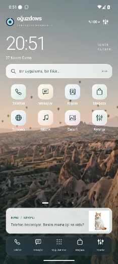

# Mobil deneyim · gerçek doğrulama kaydı

Dört düzey ayrıdır: **tarayıcı**, **SDK/Java/lint**, **sanal radyo/sağlayıcı/yükleyici emülatörü**, **gerçek SIM/cihaz/ROM**. Bir düzeyin başarısı diğerine aktarılmaz. Bu kayıt, başarısız kabul koşularını da saklar; hazırlanmış test kodu geçmiş test sayılmaz.

## 2.0 Akıncı: aynı kaynaklı tam kabul

**`5a44de0dde676d901a32be40d631d481e213439d`**, APK **`2.0.0-akinci` / versionCode20**. [46092350348](https://github.com/PeraPlusbirPasha/OguzDows/actions/runs/46092350348) / [140816933793](https://github.com/PeraPlusbirPasha/OguzDows/actions/runs/46092350348/job/140816933793): **24/24 native / 15 seçim, 20/20 JVM**, lint **0 hata / 47 uyarı / 1 bilgi**. Her zorunlu SDK/emülatör/kabul/paket/apksigner/artifact adımı başarılı; farklı koşuların kısmi başarıları toplanmadı. API35/x86_64/Google APIs/Pixel6 QEMU, 4 GiB RAM / 256 MiB heap / 720×1600 / 280dpi / SwiftShader kapsamıdır.

- [SDK makbuzu](android/evidence/sdk-5a44de0.json) · [tüm native seçimler ve bağımsız TLS makbuzları](android/evidence/emulator-5a44de0.json) · [ayrı kabul kapısı](android/evidence/acceptance-5a44de0.json) · [paket, sürüm ve imza özeti](android/evidence/package-5a44de0.json).
- **7** Telefon/SMS/origin/rol/sistem kontrolü + **1** üç iptal/son sistem kurulumu + **5** native launcher + **4** bağlı kabuk/rehber/kilit + **3** köprü/TLS/interop/MediaProjection + **4** depo güvenliği/canlı kaynak = **24**. Kabulde hiçbir seçim boş/atlanmış değildir.
- İki bağımsız uygulama dört gerçek dosyanın SHA-256’sında aynı sonucu verdi; sanal Ethernet/adb forward, fiziksel Wi-Fi/ARM değil. Gerçek MediaProjection fixture karesi **12.253 bayt**, SHA-256 `4c03fe2b035f38463a55b30794239ce4a5229ad64f1e0b37979fce82a2b4db83`; taze sistem izni, iptal, foreground servis ve durdurma geçti. Ses/uzaktan girdi yoktur.
- Ana APK **24.434.944 bayt**, SHA-256 `305015d09e57dcc18b854c3624754ed1723b2cfb2b9c3493c2b0cc6661820e82`. [Actions dağıtımı 15241623587](https://github.com/PeraPlusbirPasha/OguzDows/actions/runs/46092350348/artifacts/15241623587) **14.934.728 bayt**, ZIP digest `sha256:fa96697db925abebb40d008696945a8dbf1926e3bf67cc460c7e7068a0e382dd`. Kalıcı [2.0 Release](https://github.com/PeraPlusbirPasha/OguzDows/releases/tag/v2.0) artifact saklama süresinden ayrı tutulur. [İndir/doğrula/kur](INSTALL.md).
- **Yeni görüntü gerçekten elde edildi:** [234×519 native thumbnail](../docs/assets/oguzdows-mobile-v2.jpg), 12.959 bayt, SHA-256 `2f532a28e17c2df84030c0169a44878479b4e6df51cf9ed4d4b6e7699bff6876`. Altı checks parçası eksiksiz birleştirildi ve Pillow JPEG doğrulaması yapıldı. Bu launcher görüntüsü, yukarıdaki MediaProjection karesi değildir; fiziksel telefon da değildir. APK ve tam yakalama burada bağımsız hash’lenmedi; ham dosya/CI denetimi kapsamı ayrıdır.
- **Sağlık sınırı:** ürün ANR/çökmesi yoktu, ancak PID5337’de **2205 ms `HardwareRenderer.nSetStopped` ana iş parçacığı beklemesi** gözlendi. Native kök neden, kalıcı kararlılık veya fiziksel akıcılık/pil/RAM/FPS kanıtı değildir.

### Reddedilen 2.0 aday koşuları silinmez

| Koşu | Kaynak | Gözlenen sonuç | Dağıtım |
| --- | --- | --- | --- |
| [46091898778 PC](https://github.com/PeraPlusbirPasha/OguzDows/actions/runs/46091898778) | `ee0d471` | Python3.13, negatif tar örneğinin `addfile(size>0, fileobj=None)` oluşturulmasını reddetti; bağımlı GTK kurulum adımları atlandı ve daha sonraki zorunlu tema testi de eksik varlıkla başarısız oldu. Test gevşetilmedi; bozuk başlık fixture’ı doğru üretildi. | PC imajı oluşmadı |
| [46091903486 mobil](https://github.com/PeraPlusbirPasha/OguzDows/actions/runs/46091903486) | `ee0d471` | Launcher seçiminde `launcher-wallpapers` eksik/stock HOME görünümü; diğer seçimler, TLS ve yakalama geçti, tam kabul geçmedi. Ürün ANR/çökmesi yok; 2059 ms HWUI örneği vardı. | Paket yok |
| [46092349811 mobil](https://github.com/PeraPlusbirPasha/OguzDows/actions/runs/46092349811) | **aynı `5a44de0`** | Launcher seçiminde `StaleObjectException` ve pin menüsünde `NullPointerException`; 14/15 zorunlu seçim başarılı, launcher seçimi başarısız kabul edildi. Ürün ANR/çökmesi yok; 2220 ms HWUI örneği vardı. | Paket yok |

Kabul edilen **46092350348**, aynı kaynaklı bağımsız, paralel PR koşusudur; yukarıdaki manuel koşu yeniden başarılı gösterilmedi ve hiçbir native/odak/iptal kapısı kaldırılmadı. **Bu değişken odak/otomasyon sonuçlarının kalıcı giderildiği iddia edilmez.** Mevcut aralıklı HWUI/ANR geçmişi de aşağıda kalır; bir başarılı koşu tüm OEM/cihaz koşullarını kapsamaz.

PC/Pi imaj ve host/ABI kanıtı [birleşik sürüm notlarında](../docs/releases/v2.0.md), bağlantı adımları [AKINCI-BAGLANTI](../docs/AKINCI-BAGLANTI.md) belgesindedir. Kamuya açılmadan önce tüm yayın dosyaları ayrı runner’da tekrar indirilir; APK paket/sürüm/imzacısı ve aynı ham kabul/yakalama dosyaları yeniden denetlenir. Bu, fiziksel ürün testi yerine geçmez. Bulut AI/ASR/TTS/wake-word, GMS, gerçek modem/acil çağrı ve ROM kapıları açık kalır.

## Tarihsel tam 0.4 bağlı kabuk kabulü: `7244164`

[Başarılı koşu **46087817657**](https://github.com/PeraPlusbirPasha/OguzDows/actions/runs/46087817657) / [iş **140801439213**](https://github.com/PeraPlusbirPasha/OguzDows/actions/runs/46087817657/job/140801439213), tam kaynak **`7244164364105a00838b4a68f5815c352554a36b`**. API35 / Google APIs / x86_64 / Pixel6 QEMU, **4 GiB konuk RAM / 256 MiB heap**, 720×1600 / 280dpi / SwiftShader; iş **9m13s**. **15/15 seçimde 24/24 native vaka**, boş/atlanmış kabul yok; **20/20 JVM** (Platform6 + Launcher7 + Connected7), lint **0 hata / 47 uyarı / 1 bilgi**. Eski 17 vaka korunur; farklı koşular birleştirilmedi.

| Aynı kaynakta geçen | Vaka | Gözlenen kanıt |
| --- | ---: | --- |
| Telefon/SMS/roller/origin/ses/tema | 7 | Sanal modem, gerçek sağlayıcı/Telecom/InCallService, ücretli son onay/iptal; operatör teslimi uydurulmaz |
| APK inceleme ve sistem kurulumu | 1 | Üç zorunlu iptal: düğme → sistem Geri → düğme; inceleme örneği yıkılır, özgün HomeActivity odağı döner, paket kurulmaz. Sonra ayrı sistem onayıyla etkisiz fixture’ın sürüm/imzacısı doğrulanır |
| Native launcher | 5 | Gerçek HOME/inventory/launch, disk/bozuk kayıt, Rıfkı/ortak Telefon rengi ve gerçek widget |
| Bağlı kabuk/rehber/kilit | 4 | Altı düzen/kalıcılık, OS HOME eski örnek DESTROYED/yeni farklı aynı-task RESUMED, gerçek Ayarlar, iki tam ekran hareket, gerçek rehber/ekle/iptal/SMS taslağı ve kilit eşlikçisi |
| Köprü | 3 | Native TLS; iki yönde Python/native dört dosya ve iki bağımsız aynı SHA-256 makbuzu; gerçek MediaProjection iptal → taze sistem onayı → FGS → TLS JPEG → durdurma |
| Depo güvenliği/canlı kaynak | 4 | İmza/pin/hash/rollback; 5.057 uygulama / 5.016 API-ABI uygun paket; gerçek Aegis incelemesi kurmadan iptal |
| **Toplam** | **24** | **Tümü tek kaynakta geçti** |

- [SDK](android/evidence/sdk-7244164.json) · [native sonuçlar ve iki bağımsız dosya makbuzu](android/evidence/emulator-7244164.json) · [ayrı `acceptance.py` sonucu](android/evidence/acceptance-7244164.json) · [paket kökeni](android/evidence/package-7244164.json).
- Gerçek fixture ekranı: **11.662 bayt JPEG**, SHA-256 `1cfe029facd6d57cdae79bd00654055efe3b8dafb9934f56839fc57c949076a0`. CI kapısı çekilmiş dosyanın gerçek boyut/hash’ini ve üç değişmemiş APK’yı ayrıca doğruladı; taze izin/iptal/FGS/durdurma zorunluydu. Salt görüntü, ses/uzaktan girdi yoktur.
- [**0.4 APK/test/rapor artifact’ı**](https://github.com/PeraPlusbirPasha/OguzDows/actions/runs/46087817657/artifacts/15240450965): **14.984.290 bayt**, ZIP digest `sha256:75ce7463de1cedaa8cdbc47821e35a5ccc0157ec4f6af26cfe3d6eb3c76f06f4`, 14 gün. `apksigner verify` geçti. Ana APK **24.418.460 bayt**, SHA-256 `7213f4a94782d8a01c96af9d4aef0ab2e493cb80df4edc8b002c559b54cbe95d`; [kurulum](INSTALL.md).
- **Sağlık/performans sınırı:** bu koşuda Android ürün ANR/çökmesi görülmedi, fakat gözlemci PID5423’te **2060 ms `nSyncAndDrawFrame` beklemesi** yakaladı. Bu Java örneği korunur; native RenderThread kök nedeni veya aralıklı ANR’ın kalıcı giderildiği iddia edilmez. Fiziksel GPU/RAM/FPS/pil/gerçek SIM ve PC/telefon/ARM matrisi açık.
- **Yerel indirme/görsel sınırı:** yeni artifact ve iş logu indirmesi depolama yönlendirmesinde `EOF` verdi. APK ve tam JPEG burada yok; bağımsız yerel binary/hash/imza veya yeni ekranın görsel incelemesi yapılmadı. Altı yeni thumbnail parçasından dört tanesi checks kotasına sığdı; eksik JPEG üretilmedi. Aşağıdaki native JPEG açıkça tarihsel **0.3** olarak kalır, 0.4 kanıtı yerine geçirilmez. Tam güncel PNG/JPEG artifact’tadır.

[CONNECTED.md](CONNECTED.md) protokol/izin/sınırları ve başarısız/ANR ile kesilen eski koşuları tutar. 0.3 ve 0.2 aşağıda tarihsel kabul olarak korunur; yeni kabul yerine kullanılmadı. Yeni 24-vaka kabulü SystemUI/keyguard değişimi, ROM, GMS veya fiziksel ürün kabulü değildir.

## Son yerel kontrol ve sınırı

| Kontrol                | Gözlenen sonuç                | Sınır                                                                       |
| ---------------------- | ----------------------------- | --------------------------------------------------------------------------- |
| `npm run build`        | Başarılı                      | TypeScript + Vite 6.4.6, 1594 modül                                         |
| `npm test`             | **31 geçti, 0 atlama**        | 13 temel mantık/kanıt + 8 günlük deneyim/varlık/durum + 10 API testi                    |
| `npm run test:native`  | **31 geçti, 0 atlama**         | 20 kaynak sözleşmesi + 11 sentetik kabul/orkestrasyon/tanı/ön koşul; SDK veya cihaz testi değil                |
| `npm run test:browser` | **31 senaryo geçti**          | 15 mevcut + 16 günlük deneyim; iki kapsayıcıyla Node raporu 33/33           |
| `npm run format:check` | Başarılı                      | TSX/MJS/CSS/config/test kaynakları                                          |
| `npm audit`            | **0 raporlanan açık**         | Bu lockfile ve sorgu anı; genel güvenlik sertifikası değil                  |
| Başlangıç JS           | **99578 gzip bayt**           | Hedef ≤112640 bayt (110 KiB), geçildi                                       |
| Günlük uygulamalar JS  | **12244 gzip bayt**            | Ayrı, dinamik yüklenen modül; yukarıdaki ilk paket değildir                 |
| CSS                    | **16460 gzip bayt**           | İki stil kaynağının üretim dosyası                                          |
| Mağaza simgeleri       | **24 / 24 yerel SVG**         | Tarayıcıda her birinin gerçek yüklenmesi, manifest SHA-256/lisans kontrolü  |
| Önceki çalışma         | **633 dosyanın içeriği aynı** | Mobil işe başlamadan kaydedilen SHA-256 tabanı; PC/Pi yayını değiştirilmedi |

Gzip ölçümü Node `zlib.gzipSync` ile varsayılan sıkıştırmada alındı. Kaynak **7244164** üzerinde son temiz yerel tekrar: **33/33 Chromium TAP** (~112.7 s), **31/31 Node**, **31/31 mobil kaynak/sentetik**, build/format/audit ve **19/19 Python loopback-TLS** geçti. Aynı kaynakta bağımlılıkları kurulu `.venv/bin/python -W error::ResourceWarning -m unittest discover -s tests -q`: **727 koştu / 718 başarılı / 9 ortam atlaması**, 0 hata/başarısızlık. Sistem Python’undaki ilk bağımlılıksız deneme hata verdi ve kabul sayılmadı. Bunlar JVM/cihaz/fiziksel kanıtı değildir; üstteki 24-vaka CI kabulü ayrıdır.

Ortam: Node 22.22.3, npm 10.9.8, Python 3.11.2, sabitlenen Sparticuz Chromium 133 / Playwright Core. Chromium bir test koşucusudur, telefon emülatörü değildir. Tarayıcının web güvenliği/CORS denetimi kapatılmadı; CI için `--no-sandbox` gerekir. NSS destek kitaplıkları yalnız test önbelleğine açılır.

## Günlük deneyimde geçen 16 senaryo

1. **20 uygulama girişi:** Türkçe ad/takma ad araması; `rehber` → Kişiler, `hesap makinesi` → çalışan Hesap.
2. **Üç gerçek ana sayfa:** yatay dokunma hareketi ve sayfa düğmeleri gerçekten sayfa/uygulama değiştirir.
3. **Rıfkı’nın açık eylemi:** Telefon/Mesajlar/denetim merkezi gibi sabit yollar ancak önerilen düğmeye basılınca açılır; mesaj/arama yapılmaz.
4. **Birleşik arama:** uygulamalar, araçlar, notun 5000. karakterinden sonraki Türkçe eşleşme, basit aritmetik, ayar ve mağaza sonucu; otomatik web/model gönderimi yok.
5. **Telefon:** tuş takımı, elle numara, sil, normalleştirilmiş `tel:` ve Mesajlar’a geçiş; geçersiz/servis kodunda arama bağlantısı yok. Çağrı bağlandığı iddia edilmez.
6. **Kişiler:** ekle, favori, yeniden yükle, Türkçe ara, numara çevir, mesaj taslağı aç; silme iptal/ikinci onay akışları.
7. **SMS taslağı:** alıcı ve Türkçe/özel karakterli metin yeniden yüklemede korunur; `sms:` gövdesi güvenli kodlanır, gönderildi sayılmaz.
8. **Hareketler:** üst kenardan dokunma ve fare sürüklemesi panel açar; yukarı tutamaç kapatır; uygulama içi normal kaydırma panel açmaz; yukarı ana ekran hareketi çekmece açar.
9. **Gerçek önizleme sesi:** seçilmiş WAV gerçek HTML audio öğesine yüklenir; panel sesi `.volume`, sessiz ayarı `.muted` değerini değiştirir. Parlaklık gerçek UI karartma katmanına uygulanır; tercihler yeniden yüklemede kalır. Bu sistem ses/pil/donanım ölçümü değildir.
10. **Mağaza:** 24 yerel marka görselinin hepsi yüklenir; sekiz kategori filtrelenir; F-Droid için hayalî Play bağlantısı sunulmaz.
11. **Takvim:** ay ileri/geri, seçili gün ve yerel plan ekle/yeniden yükle/sil.
12. **Saat:** kronometre başlangıcı ve sayaç son tarihi sayfalar arasında korunur; duraklat/iptal çalışır. Sistem alarmı veya bildirim testi değildir.
13. **Tarayıcı:** script/dosya/güvensiz URL reddi; güvenli HTTPS adresi veya açık dış arama bağlantısı; iframe/otomatik sorgu yok.
14. **Galeri:** seçilen gerçek PNG baytları açılır, aynı baytlar indirilir ve yalnız geçici önizleme kaldırılır; dosya yüklemesi yok.
15. **Dar ekran/erişilebilirlik:** 14 yeni rota 320×640’ta yatay taşmaz. 390×844’te Telefon, Mesajlar, Kişiler, Takvim, Mağaza, Arama ve denetim merkezi için Axe kritik/ciddi ihlal raporlamaz; kontrast kuralı açıktır.
16. **Azaltılmış hareket:** yeni sayfa/simge/panel/plak animasyonları hem sistem reduced-motion hem hafif profil tercihini izler.

Yeni senaryolarda yakalanmamış tarayıcı/React hatası veya üçüncü tarafa otomatik ağ isteği görülmedi. SMS/call bağlantıları **güvenli URI ve arayüz düzeyinde** sınanır; gerçek telefon işleyicisi, operatör veya mesaj teslimi test edilmedi. “Sesi dene” sentetik, yalnız kullanıcı tıklamasıyla kısa önizleme sesidir; fiziksel hoparlör/ses kalitesi ölçümü değildir.

## Korunan 15 önceki senaryo

Masaüstü laboratuvarı/başlangıçta harici istek olmaması; 390px tam ekran ana sayfa; nazar güç menüsü ve modal odak/Escape/kilit; ortak tema kalıcılığı; duvar kâğıdı kalıcılığı; görev/not kaydı; 16 Atölye girişi ve kod çalıştırmayan hesap; yerel Rıfkı ve onaylı eylem; **sahte taşıma** ile model gönderim izni/eski yerel konuşmanın taşınmaması; gerçek APK bayt hash’i/uzantı reddi; istek listesi/resmî kaynak/Google HTTPS bağlantıları; örnek okuma listesi/okundu/TXT; dar ekran/azaltılmış hareket/Ayarlar Axe; bozuk kaydın iptalde korunması ve yalnız açık sıfırlama; depolama reddinde açık uyarı ve çalışan oturum.

Axe sonuçları tüm temalarda, her OEM’de, gerçek ekran okuyucuda veya tam WCAG sertifikasyonu anlamına gelmez. Yeni panelde testte yakalanan düşük kontrast giderildi; metinleri yarı saydamlaştırmayan, transform odaklı panel animasyonu kullanıldı. Yeni durum alanları eski v1 kayıtlara veri silmeden varsayılan ekler; not/görevler korunur.

## Tam native launcher kabulü: `fb6cad5` · 0.3

[Başarılı koşu **46065713858**](https://github.com/PeraPlusbirPasha/OguzDows/actions/runs/46065713858) / [iş **140730403637**](https://github.com/PeraPlusbirPasha/OguzDows/actions/runs/46065713858/job/140730403637), tam kaynak **`fb6cad5a3f56c5bf37e739388ded5ffce8e5ad13`**. SDK35 / Google APIs / x86_64 / Pixel6 QEMU, **4 GiB konuk RAM / 256 MiB heap**; toplam iş 7m09s. **11 instrumentation seçiminde 17/17 vaka**, boş/atlanmış kabul yok; **13/13 JVM testi**, lint **0 hata / 43 uyarı / 1 bilgi**. Eski 12-vaka kapsamı azaltılmadan 5 native launcher testi eklendi.

- [SDK derleme kaydı](android/evidence/sdk-fb6cad5.json): 3 APK’nın boyut/hash’i, Java/Kotlin JVM toplamı ve lint sınıfları. CI’nin eski `java_unit_tests` alanı iki dilin toplamını içerir; SDK kaydındaki `emulator_passed: null` ayrı kapsamdır.
- [Emülatör kaydı](android/evidence/emulator-fb6cad5.json): 11 seçimin tek tek sonucu, tam imaj fingerprint’i, canlı depo/inceleme ve native görsel kökeni.
- [Paket kökeni](android/evidence/package-fb6cad5.json): kaynakla eşleşen artifact ID/digest’i, başarılı paket/imza adımı ve yerel indirme sınırı.

| Korunan gerçek platform kabulü | Vaka | Yeni koşudaki sonuç |
| --- | ---: | --- |
| Köprü/roller/origin/alt çerçeve + soğuk DIAL taslağı | 1 | Geçti; gelen intent arama başlatmaz |
| Ücretli çağrı ve SMS son native onayını iptal | 1 | Geçti; çağrı veya sağlayıcıya yeni SMS yok |
| Gerçek medya sesi/pencere parlaklığı/native tema | 1 | Geçti |
| Gelen ve giden sanal SMS | 2 | Gerçek sağlayıcı ve sent callback’i; teslim raporu uydurulmaz |
| Gelen ve giden sanal çağrı | 2 | Telecom/InCallService/kendi görüşme UI’sı, yanıtla/sustur/aç/bitir |
| Etkisiz APK inceleme/iptal/sistem kurulumu | 1 | Gerçek sistem onayı ve yüklü sürüm/imzacı |
| İmzalı depo güvenliği | 3 | Bozuk/imzasız/yanlış pin, atomik seçim/rollback, izinsiz uç reddi |
| Canlı F-Droid + Aegis inceleme/kurmadan iptal | 1 | **5.057 uygulama / 5.016 API-ABI uygun paket**, Aegis code82 / 6.869.856 bayt |
| **Korunan taban** | **12** | **Tümü geçti** |

| Yeni `LauncherDeviceTest` | Vaka | Gerçekten gözlenen |
| --- | ---: | --- |
| Native HOME ve envanter | 1 | Platform HOME çözümü `LauncherActivity`; Home’da WebView yok; önceki yükleyici testinin kurduğu fixture gerçek listede. Native Cihazım ve diske yazılan Koleksiyon seçimi |
| Arama/başlatma/HOME | 1 | Kurulu fixture Türkçe adla bulunup gerçekten ön plana açılır, Home native launcher’a döner |
| Kısayol/diske yazma/bozuk kayıt | 1 | Sabitle/öne taşı; yeni ViewModel aynı sırayı diskten okur; bozuk kayıt ezilmez ve açık sıfırlama gerekir |
| Denetim/Rıfkı/Telefon geçişi | 1 | AudioManager değişir, yerel kedi ve onaylı tema önerisi çalışır; mikrofon izni yok. Telefonun hesaplanan gerçek koyu arka planı `rgb(23, 38, 43)`, Geri native HOME’a döner |
| Gerçek widget | 1 | Gerçek sağlayıcı seçimi ve sistem bağlama, kaydedilmiş ID/RemoteViews içeriği; yeni host’ta geri gelme, ID silme ve diskten kaldırma |
| **Native launcher** | **5** | **Tümü geçti; genel toplam 17** |

Bu widget testi AndroidView’ın sağlayıcıya delege ettiği erişilebilirlik ağacındaki **gerçek “Widget hazır” RemoteViews metnini** okur; var olmayan Compose test etiketi uydurulmaz. Yapılandırmalı tüm sağlayıcılar, widget yeniden boyutlandırma, iş profili veya süreç öldürme matrisi bu tek fixture’dan çıkarılmaz.

### 0.3 APK ve gerçek native görüntü

[**Launcher APK/test/rapor paketini indir**](https://github.com/PeraPlusbirPasha/OguzDows/actions/runs/46065713858/artifacts/15231331173) · [kurulum ve hash denetimi](INSTALL.md). Ana APK `OguzDows-Mobile-0.3.0-launcher-debug.apk`: **23.991.680 bayt**, CI SHA-256:

```text
622a59fd5686b09da687a6b6f7e72f24963341695b210a3addbf58c292eefb56
```

Paket ancak 17-vaka kapısından sonra hazırlandı; **`apksigner verify --verbose --print-certs` ve artifact yüklemesi geçti**. Artifact **16.692.242 bayt**, digest `sha256:060106f39032d29be2228579fd4362cac4f17a6205ad6babe35ba5857840228d`, saklama **14 gün**. Debug anahtarıdır; üretim mobil Release yoktur. Kendi indirmeni hash ile doğrula.



`UiDevice` tarafından alınan gerçek native emülatör ekranının **234×520 JPEG kalite 45** kopyası, altı sıralı checks-bildirimi parçasından geri alınıp **görsel olarak incelendi**. SHA-256: `37147bdecd792b58e44b790ba93a0901264a2105b6b05f1ced93a7e5e9d2b36f`. İçerik yeniden çizilmedi veya AI görseli üretilmedi; tam çözünürlüklü HOME/Rıfkı/Telefon/widget PNG’leri artifact’ta kalır. Bu çalışma alanında **yalnız küçültülmüş native görüntü** incelendi; bütün tam PNG’lerin incelendiği iddia edilmez.

**APK yerel indirme sınırı:** yeni artifact için `gh run download` denendi, izinli olmayan blob depolama yönlendirmesinde yine `EOF` döndü. Ana/test APK baytları burada yok; bağımsız yerel APK hash/imza kontrolü yapılamadı. Hash/boyut CI bildiriminden, ZIP digest’i GitHub API’den gelir. Git’e APK/SDK/anahtar eklenmedi ve indirme engelini aşmak için Release açılmadı.

### 0.3 başarısız geçmişi ve dar emülatör hazırlığı

| Koşu / kaynak | Gözlenen sonuç | Kanıt / paket |
| --- | --- | --- |
| [46057228221 / `d13b34e`](https://github.com/PeraPlusbirPasha/OguzDows/actions/runs/46057228221) | **11/17**, yükleyici ANR’ı ve 5 launcher hatası | [SDK](android/evidence/sdk-d13b34e.json), [cihaz](android/evidence/emulator-d13b34e.json); paket yok |
| [46058514509 / `8257892`](https://github.com/PeraPlusbirPasha/OguzDows/actions/runs/46058514509) | **3/17**, sistem ANR pencereleri/odak zaman aşımı | [SDK](android/evidence/sdk-8257892.json), [cihaz](android/evidence/emulator-8257892.json); paket yok |
| [46060372246 / `c174b6d`](https://github.com/PeraPlusbirPasha/OguzDows/actions/runs/46060372246) | **Kısmi:** 4/5 launcher; sağlayıcı etiketi hatası, gerçek HWUI main-thread ANR izi | [SDK](android/evidence/sdk-c174b6d.json), [kısmi iz](android/evidence/launcher-c174b6d.json); tam sonuç uydurulmaz, paket yok |
| [46061542455 / `2be89d7`](https://github.com/PeraPlusbirPasha/OguzDows/actions/runs/46061542455) | 6/8 taban, 4/5 launcher gözlemi; ücretli onay/SMS ve widget test etiketi hatası | [SDK](android/evidence/sdk-2be89d7.json), [başarısız cihaz](android/evidence/emulator-2be89d7.json); paket yok |
| [46062951301 / `ece0f3b`](https://github.com/PeraPlusbirPasha/OguzDows/actions/runs/46062951301) | Sistem penceresi bütün UI’ları örttü; özet JSON bildirim sınırında kesildi | [SDK](android/evidence/sdk-ece0f3b.json), [özgün kesik bildirim ve hata kayıtları](android/evidence/emulator-ece0f3b-partial.json); eksik sonuca başarı yazılmaz |
| [46065058564 / `5433564`](https://github.com/PeraPlusbirPasha/OguzDows/actions/runs/46065058564) | **0 ürün testi**; APK kurulmadan **Pixel Launcher isn’t responding** yakalandı | [SDK](android/evidence/sdk-5433564.json), [stok boot kanıtı](android/evidence/emulator-5433564.json); paket yok |
| [46065713858 / `fb6cad5`](https://github.com/PeraPlusbirPasha/OguzDows/actions/runs/46065713858) | **17/17 + paket/imza/yükleme geçti** | Yukarıdaki kabul edilmiş 0.3 artifact |

`c174b6d` HWUI `syncAndDrawFrame` beklemesi gerçek bir izdir; bütün sorunların başlatıcı kök nedenini tek başına kanıtlamaz. Başka koşuda ürün kurulmadan görülen stok Pixel Launcher ANR’ı ayrıca teşhis edildi. Sürücü yalnız **tanınmış stok paket + tam stok ANR başlığı** için, yalnız QEMU hazırlığında gerçek “Close app” düğmesinden kapatma ve stok paketi durdurmaya izin verir. Yapılırsa `stock_boot_recovery` kaydına yazılır. **Başarılı `fb6cad5` koşusunda bu istisna kullanılmadı.** OğuzDows/başka uygulama ANR’ı kapatılıp başarıya çevrilmez; ürün ANR’ında iz alınır ve eksik kabul paketlenmez.

4 GiB AVD, SwiftShader/GL, kapalı Vulkan ve derleme JVM’inde Kotlin yalnız CI kaynak/renderer hazırlığıdır; fiziksel telefona optimizasyon olarak uygulanmaz. SIM durumu tam `READY`/`LOADED` olmalıdır, `NOT_READY` eşleşmesi kabul edilmez. Hata bildirimlerinin sınırı tam raporu bozmaz; uzun loglar artifact’ta, kompakt JSON bildiriminde sonuçlar korunur. Ücretli onay, rol uygunluğu, gerçek yükleyici testiyle kurulan fixture ve **17 vaka** düşürülmedi.

## Tarihsel 0.2 kabul tabanı: `023a89c`

[Başarılı koşu **46048445728**](https://github.com/PeraPlusbirPasha/OguzDows/actions/runs/46048445728) / [iş **140673465222**](https://github.com/PeraPlusbirPasha/OguzDows/actions/runs/46048445728/job/140673465222), tam kaynak **`023a89c9f22bdcd27eabecf8437b05addcab03e9`**. SDK35 / Google APIs / x86_64 / Pixel6 QEMU. **10 instrumentation seçiminde 12/12 gerçek test**, 0 boş/atlanmış kabul; **6/6 Java**, lint **0 hata / 37 uyarı**. SDK, cihaz ve paket kaydı birbirinden ayrıdır:

- [SDK derleme kaydı](android/evidence/sdk-023a89c.json): APK boyutları/hash’leri, Java sonuçları ve lint uyarı sınıfları. `emulator_passed: null` yalnız SDK kaydının kapsamıdır, kabul başarısızlığı değil.
- [Emülatör kaydı](android/evidence/emulator-023a89c.json): tek tek geçen cihaz testleri, imaj fingerprint’i ve canlı kaynak kanıtı.
- [Paket kökeni](android/evidence/package-023a89c.json): başarılı paket/imza adımı, artifact ID/digest’i ve yerel indirme sınırı.

| Gerçek Android testi | Geçen vaka | Gözlenen kapsam / sınır |
| --- | ---: | --- |
| Paketlenmiş köprü ve yalıtım | 1 | Rol durumu/istek reddi, origin/main-frame ve alt çerçeve sınırı; soğuk `ACTION_DIAL` yalnız taslak oluşturur |
| Ücretli eylem onayı | 1 | Çağrı/SMS son yerel onayında iptal → çağrı ve sağlayıcıya giden SMS yok |
| Sistem denetimi ve tema | 1 | AudioManager medya sesi, uygulama pencere parlaklığı, native tema tercihi; fiziksel ses/ışık/pil ölçümü değil |
| Gelen SMS | 1 | Sanal modem PDU’su → korumalı alıcı → gerçek sağlayıcı → zengin gelen kutusu |
| Giden SMS | 1 | Önce `queued`, ardından gerçek sanal radyo sent callback’i ve sağlayıcı `SENT`; **operatör teslim raporu yok** |
| Giden çağrı | 1 | Telecom ve OğuzDows InCallService; gerçek `DIALING`/`CONNECTING`/`ACTIVE` durumlarından biri ve bitirme. Fiziksel karşı tarafla bağlantı kanıtı değil |
| Gelen çağrı | 1 | Sanal modem → `RINGING`, kendi UI’da yanıtla → `ACTIVE`, mikrofon sustur/aç ve bitir |
| APK iptal/kurulum | 1 | Özel kopya incelemesi, iptal, gerçek sistem yükleyicisi onayı, etkisiz fixture’ın yüklü sürüm/imzacı doğrulaması |
| Depo güvenliği | 3 | Ayrı anahtarlı imzalı/bozuk/imzasız JAR ve yanlış pin; SQLite seçim/rollback; izinsiz uç reddi |
| Canlı F-Droid | 1 | **5.057 uygulama / 5.016 API-ABI uygun paket**; Aegis code82, **6.869.856 bayt**, SHA-256 doğrulamalı indir/incele/**kurmadan iptal** |
| **Toplam** | **12** | Yalnız bu API35/QEMU kapsamı; tüm servis/uygulama/OEM kabulü değil |

Aegis inceleme hash’i: `0eecec45de0da3ff1358004b51e2960d9178551643a6ed44f6496ea9ec999c19`. Katalog sayıları koşu anının gözlemidir; uygun paket seçimi her uygulamanın çalışacağını garanti etmez. Canlı üçüncü taraf APK’sı kurulmadı; gerçek sistem kurulumu ayrı etkisiz fixture üzerindedir.

### Hazırlanan APK ve indirme

**[APK/test/rapor artifact’ı](https://github.com/PeraPlusbirPasha/OguzDows/actions/runs/46048445728/artifacts/15222979423)** · [kurulum ve hash kontrolü](INSTALL.md). Ana dosya: `OguzDows-Mobile-0.2.0-emulator-debug.apk`, **6.993.130 bayt**; SHA-256:

```text
175c471a87d9c6020d29a8a8cbca7a3903eb05e939c0c5fd32c26790917c2f04
```

Yalnız tam kabulden sonra paketleme adımı çalıştı; **`apksigner verify` başarılı**, APK/test/fixture, `APK-SIGNATURE.txt`, `SHA256SUMS`, `BUILD.txt` ve raporlar artifact’a yüklendi. Bu **debug/test dağıtımıdır**, üretim imzası veya mobil Release değil. Saklama süresi **14 gün**; tekrar üretim komutları [Android kılavuzunda](android/README.md).

**Yerel doğrulama sınırı:** `gh run download` GitHub’ın blob depolama alanına yönlenince sandbox ağ izinleri nedeniyle `EOF` verdi. APK baytları çalışma alanına alınamadı; burada bağımsız APK hash/imza doğrulaması veya artifact açma yapılmadı. Yukarıdaki hash ve boyut CI bildiriminden, artifact digest’i GitHub API’den alınmıştır. İndiren kullanıcı kendi kopyasını `SHA256SUMS` ile doğrulamalıdır. Ağ sınırını aşmak için APK/SDK/anahtar Git’e eklenmedi veya yeni bir Release açılmadı.

### Korunan başarısız koşular ve düzeltmeler

| Koşu / kaynak | Gözlenen sonuç | Paket |
| --- | --- | --- |
| [46044480983 / `384e905`](https://github.com/PeraPlusbirPasha/OguzDows/actions/runs/46044480983) | **5/12 geçti, başarısız**; beş JS callback hatası, kurulum düğmesi ve belirsiz canlı inceleme hatası | Hazırlanmadı; [kayıt](android/evidence/emulator-384e905.json) |
| [46046215253 / `be00308`](https://github.com/PeraPlusbirPasha/OguzDows/actions/runs/46046215253) | **10/12 geçti, başarısız**; dotless `ı` içeren çağrı düğmesi seçimi ve iki ayrı snapshot arasında çağrının kaldırılması yarışı | Hazırlanmadı; [kayıt](android/evidence/emulator-be00308.json) |
| [46047473237 / `a2eafe4`](https://github.com/PeraPlusbirPasha/OguzDows/actions/runs/46047473237) | **11/12 geçti, başarısız**; soğuk intent action/data’sını değiştirmek AndroidX ActivityScenario kapanış takibini bozdu | Hazırlanmadı; [kayıt](android/evidence/emulator-a2eafe4.json) |
| [46048445728 / `023a89c`](https://github.com/PeraPlusbirPasha/OguzDows/actions/runs/46048445728) | **12/12 geçti**; tüm kapılar ve paketleme başarılı | Yukarıdaki debug artifact |

Test düzeltmeleri: odaklanmış/yüklenmiş WebView bekleme; navigasyon/yerel onay sırasında JS dönüşünü beklememe; ön planda JS sorgulama; Türkçe `iIıİ` düğme seçimi; çağrı durumunu tek snapshot üzerinden okuma; görünür Activity’den yükleyici başlatma; anlamlı canlı kaynak assertion’ları. Ürün düzeltmeleri: React dinleyicisi → `ui.ready` el sıkışmasıyla kaybolmayan soğuk başlangıç taslağı; intent action/data’sını değiştirmeden ayrı, kaydedilen tüketim durumu; eksik/geçersiz imzacı özetinde kurulum/başarı kapısını kapatma. İzin, ücretli onay veya 12 vaka kapısı gevşetilmedi.

İlk çalıştırıcı revizyonu kendi runtime bağımlılıklarını içermediği için emülatör başlamamıştı. Paketlenmiş **v2.34.0 / `1dcd0090116d15e7c562f8db72807de5e036a4ed`** ile gerçek emülatör çalıştı. Google APIs imajı, Play Store/GMS sertifikası veya fiziksel ürün desteği değildir.

Kabul sürücüsü yalnız tek `emulator-*` ve `ro.kernel.qemu=1` hedefinde çalışır; rol uygunluğunu atlamadan Telefon/SMS rollerini seçer, yalnız bu harcanabilir hedefte izin/kaynak ayarlarını yapar. Gerçek SIM/acil numara kullanılmaz. Rol/izin reddi ve geri alma matrisi bu olumlu koşuya dahil değildir. `test-results/mobile/build.json`, `emulator/evidence.json`, log/ekran/rapor dosyaları hata halinde de artifact’a alınır; kısa bildirimler GitHub checks API’den okunur. Kalıcı özetler Git’teki yukarıdaki JSON’lardır, büyük üretilmiş dosyalar değildir.

## API ve native kaynak sınırı

API testleri: kapalı varsayılan; HTTPS/sunucu-loopback uç kısıtı; gönderim başlığı/onayı ve rol/sayı/uzunluk doğrulaması; sunucuda sabit sistem promptu; model araçlarının olmaması; gövde/yanıt sınırı; anahtar/hata sızdırmama; IP hız sınırı; yabancı Origin reddi ve iki inference eşzamanlılık kapısı. Gerçek sağlayıcı, model kalitesi, veri saklama ve üretim oturum doğrulaması test edilmedi.

15 kaynak sözleşmesi; açık manifest izinleri/rol bileşenleri, origin/ana çerçeve/CSP, ücretli işlem onayı ve doğruluk, APK özel kopyası/yükleyici, depo güven kökü/imza/hash/rollback, yardımcı mikrofonunun kapalı kalması, gerçekten bağlı native Telefon/Mesaj ve HOME dönüş rotaları, Compose HOME/gerçek inventory/widget/düzen sınırları, mevcut dört duvar kâğıdının byte/lisans kökeni, emülatör güvenlik kilitleri ve 24 vektörün path/lisans/hash eşleşmesini denetler. Bunlar **statik kaynak sözleşmeleridir**, çalışan cihaz kanıtı değildir. Gerçek SDK sonucu ve yalnız geçen emülatör adımları üstte ayrıca belirtilir.

AOSP yardımcı metadata’sının zorunlu `recognitionService` alanı kaynak incelemesiyle eklenmişti; tanıma iskeleti mikrofon açmadan hata döndürür. Üç yardımcı servisi `BIND_VOICE_INTERACTION` imza izniyle kısıtlıdır. İncelenen AOSP 15 kaynakları:

- [VoiceInteractionServiceInfo](https://github.com/aosp-mirror/platform_frameworks_base/blob/android-15.0.0_r1/core/java/android/service/voice/VoiceInteractionServiceInfo.java)
- [VoiceInteractionService](https://github.com/aosp-mirror/platform_frameworks_base/blob/android-15.0.0_r1/core/java/android/service/voice/VoiceInteractionService.java)
- [RecognitionService](https://github.com/aosp-mirror/platform_frameworks_base/blob/android-15.0.0_r1/core/java/android/speech/RecognitionService.java)

## Tarihsel 0.3 kapsamında özellikle yapılmayanlar

- API35/QEMU kabulünün ötesinde fiziksel ürün/üretim dağıtım kabulü yoktur. AOSP/GSI/boot/vendor/ROM üretimi, unlock/flash/root yapılmadı; artifact yerel olarak indirilemedi.
- GMS/Play dağıtımı, lisans/sertifika, CTS/VTS, Play Integrity, banka veya DRM uygulaması testi.
- Fiziksel SIM/operatör/VoLTE/VoWiFi/acil çağrı, sistem rehberi/takvim erişimi, gerçek kamera/radyo/GPU/ses kalitesi veya pil ölçümü. Sanal gelen çağrı ve ses API testi fiziksel donanım kanıtı değildir.
- Canlı üretken model, mikrofon, ASR/hotword veya ekran bağlamı okuma.
- Gerçek pil ömrü/RAM/FPS/termal ölçümü veya tüm masaüstü özelliklerinin native tamamlandığı iddiası.
- Mevcut PC/Pi dosyaları, yayımlanmış imajlar veya PR/release işlemlerine müdahale.

Kapsam: [özellik eşlemesi](feature-parity.json) · [kaynak/lisans atıfları](ASSETS.md) · [çalıştırma ve tekrar üretim](README.md). Native JPEG çalışan QEMU’dan, web ekranları çalışan tarayıcıdan alınmıştır; fiziksel telefon fotoğrafı veya ROM testi değildir.
